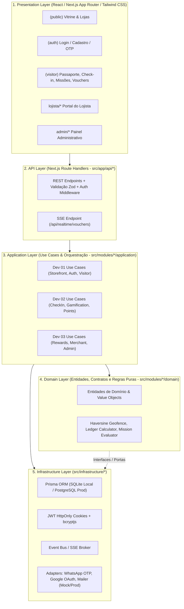
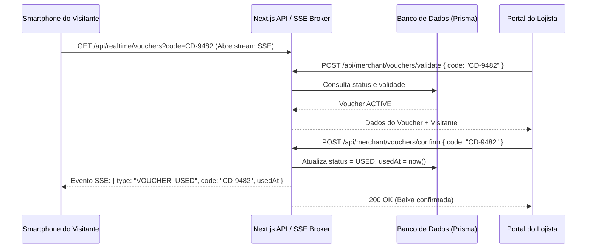

# Arquitetura Técnica — Passaporte Digital Gamificado

## 1. Visão Geral da Arquitetura

O sistema adota uma **Arquitetura Monolítica Modular em 5 Camadas** construída sobre **Next.js (App Router)** e **TypeScript**. Essa abordagem foi escolhida para permitir que **três desenvolvedores trabalhem simultaneamente** em **nove módulos de negócio independentes** sem conflitos de arquivos, mantendo simplicidade operacional de deploy único e transações ACID compartilhadas no banco de dados.



---

## 2. Stack Tecnológica Oficial

| Camada / Função | Tecnologia | Justificativa Arquitetural |
| :--- | :--- | :--- |
| **Linguagem** | TypeScript 5+ | Tipagem estática ponta a ponta e segurança nos contratos entre os 3 desenvolvedores. |
| **Framework Web & API** | Next.js (App Router) | Unifica Server Components, Client Components interativos e Route Handlers (`src/app/api`) em um único repositório modular. |
| **Interface (UI)** | React 19 + Tailwind CSS | Produtividade e fidelidade à estética *Warm Editorial Mall* com design tokens centralizados. |
| **Banco de Dados Oficial (Dev & Prod)** | **PostgreSQL (Neon Serverless)** | SGBD oficial único com suporte a *Connection Pooling* (`DATABASE_URL`), *Direct Connection* (`DIRECT_URL` para migrations), `ENUM` nativos do PostgreSQL e *Database Branching* para os 3 desenvolvedores. |
| **ORM** | Prisma (`provider = "postgresql"`) | Schema declarativo tipado, migrações versionadas no Neon e suporte nativo a transações interativas (`prisma.$transaction`). |
| **Formato da Aplicação** | **WebApp Responsivo (PWA)** | Acesso instantâneo via navegador mobile e desktop sem fricção de download em loja de aplicativos, com suporte a instalação (`manifest.json`). |
| **Validação de Dados** | Zod | Validação determinística de payloads HTTP, query params e variáveis de ambiente (`src/shared/schemas`). |
| **Autenticação** | JWT (`HttpOnly` Cookies) + `bcryptjs` | Proteção contra XSS no armazenamento do token e hash seguro de senhas sem peso de sessões stateful no servidor. |
| **Tempo Real** | Server-Sent Events (SSE) | Comunicação unidirecional leve sobre HTTP padrão para notificar a carteira do visitante assim que o lojista valida um voucher. |
| **QR Code** | `html5-qrcode` (leitura) e `qrcode` (geração) | Leitura via câmera web mobile no navegador (sem exigir app nativo) e renderização de QR Codes para vouchers e lojas. |
| **Geolocalização** | HTML5 Geolocation API + Fórmula de Haversine | Captura de coordenadas no cliente com validação matemática server-side contra o geofence do shopping (250m). |
| **Aplicação Mobile** | PWA (`manifest.json` + Service Worker) | Experiência instalável na tela inicial do smartphone com aparência nativa. |

---

## 3. Detalhamento das 5 Camadas

### 3.1 Presentation Layer (`src/app/*` e `src/components/*`)
- Contém exclusivamente páginas do App Router, layouts por contexto (`(public)`, `(auth)`, `(visitor)`, `lojista`, `admin`) e componentes visuais reutilizáveis.
- **Regra de Ouro:** Componentes visuais **nunca** executam cálculos de negócio (como validação definitiva de geofence ou cálculo de saldo) nem acessam o Prisma diretamente em Client Components.

### 3.2 API Layer (`src/app/api/*`)
- Route Handlers responsáveis por:
  1. Extrair e validar o token JWT do cookie `HttpOnly` e verificar permissões (`RBAC`).
  2. Validar o corpo (`body`) e parâmetros (`query`/`params`) com schemas `Zod`.
  3. Invocar o Caso de Uso (*Application Service*) correspondente do módulo.
  4. Padronizar a resposta JSON (`ApiResponse<T>`) e os códigos de status HTTP.

### 3.3 Application Layer (`src/modules/<modulo>/application/*`)
- Orquestra o fluxo de cada funcionalidade.
- Exemplo: O caso de uso `PerformCheckInUseCase` (Módulo 04) valida a loja, solicita ao serviço de domínio a validação Haversine, persiste o check-in e dispara os casos de uso de concessão de carimbo/missão (Módulo 05) e crédito de pontos (Módulo 06) dentro de uma unidade de trabalho.

### 3.4 Domain Layer (`src/modules/<modulo>/domain/*`)
- Contém regras de negócio puras em TypeScript, sem dependência de HTTP ou framework:
  - Cálculo trigonométrico de Haversine e validação de raio de geofence.
  - Regras de elegibilidade de check-in único diário por loja.
  - Regras de progressão de nível do passaporte e conclusão de missões.
  - Invariantes do ledger de pontos (proibição de saldo negativo e obrigatoriedade de trilha de auditoria).
  - Regras de expiração e transições de estado de vouchers (`ACTIVE -> USED`).

### 3.5 Infrastructure Layer (`src/infrastructure/*`)
- Implementa detalhes técnicos concretos:
  - `database/`: Cliente Prisma singleton e repositório de dados mockados para desenvolvimento desacoplado.
  - `authentication/`: Geração/verificação de JWT, leitura/escrita de cookies `HttpOnly` e hashing `bcryptjs`.
  - `realtime/`: Gerenciador de conexões Server-Sent Events (SSE) para notificação instantânea de vouchers.
  - `integrations/`: Adaptadores para serviços externos (WhatsApp OTP, Google OAuth, E-mail), operando com *Safe Mock Adapters* enquanto credenciais de produção não são definidas.

---

## 4. Isolamento entre os 9 Módulos e Comunicação Interna

Cada uma das 9 funcionalidades reside em sua própria pasta dentro de `src/modules/`:

```text
src/modules/
├── storefront/       # Dev 01 - Funcionalidade 01
├── authentication/   # Dev 01 - Funcionalidade 02
├── visitor/          # Dev 01 - Funcionalidade 03
├── checkin/          # Dev 02 - Funcionalidade 04
├── gamification/     # Dev 02 - Funcionalidade 05
├── points/           # Dev 02 - Funcionalidade 06
├── rewards/          # Dev 03 - Funcionalidade 07
├── merchant/         # Dev 03 - Funcionalidade 08
└── administration/   # Dev 03 - Funcionalidade 09
```

**Regras de Comunicação entre Módulos:**
1. Um módulo **não** deve importar arquivos internos privados de outro módulo; toda comunicação entre módulos ocorre através do `index.ts` (API pública do módulo) ou dos contratos definidos em `src/shared/types/domain.ts`.
2. Operações que cruzam fronteiras entre desenvolvedores (ex.: `rewards` do Dev 03 precisando debitar pontos no módulo `points` do Dev 02) utilizam a interface pública `PointsServiceContract` documentada e tipada em `src/shared/types/`.

---

## 5. Estratégia de Tempo Real (Server-Sent Events)

Quando o visitante abre um voucher ativo na tela do seu smartphone, o cliente abre uma conexão `EventSource` para `GET /api/realtime/vouchers?code=<VOUCHER_CODE>`.


