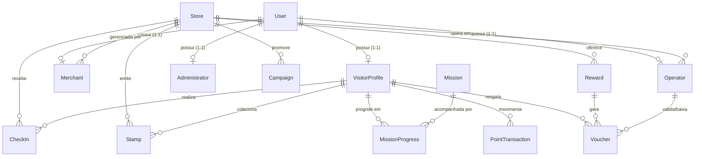

# Modelagem de Banco de Dados — Passaporte Digital Gamificado

## 1. Estratégia Oficial de Banco de Dados: Neon Serverless PostgreSQL

- **Plataforma e Administrador do Banco:** **Neon (Serverless PostgreSQL)** (`https://console.neon.tech`).
- **Linguagem / SGBD Único:** **PostgreSQL 16+** em todos os ambientes (desenvolvimento, homologação e produção), eliminando diferenças de dialeto SQL e permitindo o uso de `ENUM` nativos do PostgreSQL, `@db.Text`, índices compostos e transações ACID rigorosas para o WebApp.
- **Conexão Dual Otimizada para WebApp (Pooler + Direct):**
  1. `DATABASE_URL` (**Pooled Connection** com `-pooler` e `?sslmode=require&pgbouncer=true`): utilizada em tempo de execução pelas rotas do WebApp Next.js para suportar alta concorrência de visitantes escaneando QR Codes no shopping.
  2. `DIRECT_URL` (**Direct Connection** sem `-pooler`): utilizada exclusivamente pelo Prisma CLI (`npx prisma migrate dev` / `npx prisma db push`) para aplicar migrações de schema.
- **Estratégia de Database Branching no Neon para os 3 Desenvolvedores:**
  - `main` (Produção / Homologação estável)
  - `develop` (Branch de integração do banco)
  - `dev-01`, `dev-02` e `dev-03` (Branches isoladas no Neon para cada desenvolvedor testar migrações sem impactar os colegas).

---

## 2. Diagrama Entidade-Relacionamento (DER)

---

## 3. Descrição das Entidades Principais (13 Domínios Obrigatórios + Governança)

### 3.1 `User` (Conta Base de Autenticação)
Armazena credenciais, papel principal (`VISITOR`, `MERCHANT`, `OPERATOR`, `ADMIN`), status de verificação OTP e aceite LGPD.
- **Campos-chave:** `id`, `name`, `email` (único), `phone` (único), `passwordHash`, `role`, `isPhoneVerified`, `lgpdConsentAt`, `lgpdConsentVersion`, `isActive`, `createdAt`, `updatedAt`.

### 3.2 `VisitorProfile` (Passaporte do Visitante)
Representa o passaporte digital e o estado consolidado de gamificação do visitante.
- **Campos-chave:** `id`, `userId` (único), `memberCode` (ex.: `CD-2026-0001`), `level` (`BRONZE`, `SILVER`, `GOLD`, `DIAMOND`), `currentPoints` (cache sincronizado via transação com o ledger), `lifetimePoints`, `totalCheckIns`, `totalStamps`.

### 3.3 `Store` (Loja ou Operação Parceira)
Representa uma loja, quiosque ou operação do Capim Dourado Shopping.
- **Campos-chave:** `id`, `slug` (único), `name`, `category`, `floor`, `unitNumber`, `description`, `logoUrl`, `coverUrl`, `qrCodeToken` (token oficial para check-in), `checkInPoints` (padrão de pontos por visita), `latitude`, `longitude`, `isActive`.

### 3.4 `Campaign` (Campanha Promocional)
Campanhas sazonais ou promocionais criadas por lojistas ou pela administração.
- **Campos-chave:** `id`, `storeId` (opcional se campanha global do shopping), `title`, `slug`, `description`, `bannerUrl`, `bonusMultiplier`, `status` (`DRAFT`, `PENDING_APPROVAL`, `APPROVED`, `REJECTED`, `ENDED`), `startsAt`, `endsAt`, `approvedByAdminId`.

### 3.5 `CheckIn` (Registro de Presença Auditado)
Registra cada tentativa de check-in presencial via QR Code e GPS.
- **Campos-chave:** `id`, `visitorId`, `storeId`, `checkInDate` (`YYYY-MM-DD` no fuso local para constraint única diária), `latitude`, `longitude`, `distanceMeters`, `isWithinGeofence`, `status` (`VALID`, `REJECTED_DISTANCE`, `REJECTED_DUPLICATE`, `REJECTED_QR`), `pointsAwarded`, `createdAt`.
- **Índice de Unicidade Lógica:** Apenas um check-in com `status = VALID` por combinação `(visitorId, storeId, checkInDate)`.

### 3.6 `Stamp` (Carimbo Digital Conquistado)
Representa um carimbo conquistado pelo visitante no seu passaporte ao visitar uma loja ou evento.
- **Campos-chave:** `id`, `visitorId`, `storeId`, `checkInId`, `badgeTitle`, `category`, `earnedAt`.

### 3.7 `Mission` & `MissionProgress` (Missões e Progresso)
Define desafios gamificados (`DAILY`, `WEEKLY`, `MONTHLY`, `SPECIAL`) e o progresso individual de cada visitante.
- **Campos `Mission`:** `id`, `code`, `title`, `description`, `frequency`, `targetType` (`CHECKIN_COUNT`, `CATEGORY_VARIETY`, `SPECIFIC_STORE`), `targetCategory`, `targetCount`, `rewardPoints`, `isActive`, `startsAt`, `endsAt`.
- **Campos `MissionProgress`:** `id`, `visitorId`, `missionId`, `currentCount`, `status` (`IN_PROGRESS`, `COMPLETED`, `EXPIRED`), `completedAt`, `periodKey` (ex.: `2026-W46` ou `2026-11`).

### 3.8 `PointTransaction` (Ledger Auditável de Pontos)
Tabela imutável (append-only) que registra cada entrada ou saída de pontos.
- **Campos-chave:** `id`, `visitorId`, `type` (`CREDIT`, `DEBIT`), `amount`, `balanceAfter`, `origin` (`CHECKIN`, `MISSION`, `REWARD_REDEMPTION`, `PROMO_BONUS`, `ADMIN_ADJUSTMENT`), `referenceId` (ID do check-in, missão ou voucher), `description`, `createdAt`.

### 3.9 `Reward` (Recompensa / Oferta Resgatável)
Benefício, brinde ou cupom disponibilizado no catálogo em troca de pontos.
- **Campos-chave:** `id`, `storeId`, `title`, `description`, `rules`, `imageUrl`, `pointsCost`, `initialStock`, `availableStock`, `maxPerVisitor`, `voucherValidityHours` (padrão: 24h ou 2h conforme regra da loja), `approvalStatus` (`PENDING`, `APPROVED`, `REJECTED`), `isActive`.

### 3.10 `Voucher` (Cupom Emitido ao Visitante)
Título único gerado no resgate de uma recompensa, apresentado no balcão da loja.
- **Campos-chave:** `id`, `code` (único, ex.: `VCH-CD-8941`), `qrPayload`, `visitorId`, `rewardId`, `storeId`, `pointsSpent`, `status` (`ACTIVE`, `USED`, `EXPIRED`, `CANCELLED`), `issuedAt`, `expiresAt`, `usedAt`, `validatedByOperatorId`.

### 3.11 `Merchant` (Lojista Responsável)
Vínculo de gestão comercial entre um usuário e uma loja parceira.
- **Campos-chave:** `id`, `userId` (único), `storeId`, `cnpj`, `jobTitle`, `isApproved`, `createdAt`.

### 3.12 `Operator` (Operador de Balcão/Caixa)
Credencial operacional vinculada a uma loja para leitura e baixa rápida de vouchers sem permissão de alterar configurações sensíveis da loja.
- **Campos-chave:** `id`, `userId` (único), `storeId`, `BadgeNumber`, `canManageOffers`, `isActive`, `createdAt`.

### 3.13 `Administrator` (Administrador do Shopping)
Credencial de governança da administração do Capim Dourado Shopping.
- **Campos-chave:** `id`, `userId` (único), `department`, `permissionLevel` (`SUPER_ADMIN`, `MARKETING`, `AUDITOR`), `createdAt`.

---

## 4. Regras de Integridade no Banco de Dados

1. **Proibição de Atualização Direta de Saldo:** O campo `VisitorProfile.currentPoints` jamais pode ser atualizado isoladamente. Toda atualização ocorre exclusivamente dentro do método transacional `PointsLedgerService.recordTransaction()`, que insere o registro em `PointTransaction` e atualiza `currentPoints` na mesma transação ACID.
2. **Controle de Concorrência de Estoque:** O resgate de `Reward` utiliza decremento atômico condicionado (`WHERE id = :id AND availableStock > 0`) dentro de `prisma.$transaction`, impedindo que dois resgates simultâneos deixem o estoque negativo.
3. **Baixa Única de Voucher:** A confirmação de uso do voucher valida atomicamente `WHERE code = :code AND status = 'ACTIVE'`, garantindo que um voucher nunca seja utilizado duas vezes.
