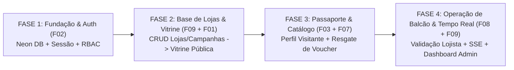

# Plano de Execução — 6 Features (Dev 01 + Dev 03) + Integração com Dev 02 e UI/UX

Este plano foi desenhado sob medida para a divisão real da equipe:
- **Você (Cristiano — Dev 01 + Dev 03):** Responsável pelas **6 Funcionalidades de Entrada, Comércio e Governança** (`F01`, `F02`, `F03`, `F07`, `F08`, `F09`).
- **Amigo 01 (Dev 02):** Responsável pelas **3 Funcionalidades de Gamificação e Pontuação** (`F04 Check-in QR/GPS`, `F05 Carimbos/Missões`, `F06 Sistema de Pontos/Extrato`).
- **Amigo 02 (Especialista UI/UX & Frontend):** Responsável pelo **refinamento visual das telas**, componentes compartilhados (`src/components/*`), fidelidade aos protótipos (`prototipos/*`) e responsividade Mobile-First (*Warm Editorial Mall*).

---

## 1. Por que juntar Dev 01 + Dev 03 com você é uma grande vantagem arquitetural?

As 6 funcionalidades que ficaram com você formam um **ciclo fechado de ponta a ponta**:
1. Você cadastra/gerencia as **Lojas, Campanhas e Recompensas no Admin (`F09`)** e no **Portal do Lojista (`F08`)**.
2. Esses mesmos dados alimentam diretamente a **Vitrine Pública (`F01`)** e o **Catálogo de Recompensas (`F07`)**.
3. Você controla a **Autenticação (`F02`)** que protege tanto o **Passaporte do Visitante (`F03`)** quanto o **Portal do Lojista (`F08`)** e o **Painel Admin (`F09`)**.

Enquanto isso, a única fronteira técnica entre **Você (Dev 01 + Dev 03)** e o **Amigo 01 (Dev 02)** é:
- Na **F03 (Passaporte)**: ler o saldo/nível/carimbos que o Dev 02 grava.
- Na **F07 (Resgate de Recompensa)**: chamar `PointsLedgerService.recordDebit(...)` do módulo `points` (Dev 02) para descontar os pontos do visitante ao emitir o voucher.

---

## 2. Roteiro de Ataque em 4 Fases (Ordem Ideal para Construir as 6 Features)

---

### FASE 1 — Autenticação, Sessão e Conexão Neon PostgreSQL (`F02`)
> **Objetivo:** Destravar o login/cadastro real no banco Neon para todos os perfis (`VISITOR`, `MERCHANT`, `OPERATOR`, `ADMIN`).

- **Arquivos onde você vai atuar:**
  - `src/modules/authentication/index.ts`
  - `src/infrastructure/authentication/session.ts` e `neon-auth.ts`
  - `src/app/api/auth/register/route.ts` e `src/app/api/auth/login/route.ts`
- **Checklist de Entrega da Fase 1:**
  - [ ] Preencher a senha do banco Neon em `.env` e rodar `npx prisma db push` + `npx tsx prisma/seed.ts`.
  - [ ] Trocar a busca em memória de `AuthenticationService.registerVisitor` por `prisma.user.create` + criação automática do `VisitorProfile` (nível inicial `BRONZE`, código `CD-2026-XXXX`).
  - [ ] Trocar `AuthenticationService.authenticateUser` por busca no Prisma (`prisma.user.findFirst` por `email` ou `phone`) + validação de senha com `verifyPassword` (`bcryptjs`).
  - [ ] Validar emissão do cookie `HttpOnly` (`passaporte_cd_session`) e redirecionamento por `role` (`/passaporte`, `/lojista`, `/admin`).
  - [ ] Criar rota `POST /api/auth/logout` para limpar o cookie de sessão.

---

### FASE 2 — Gestão de Lojas/Campanhas (`F09 parcial`) + Vitrine Pública (`F01`)
> **Objetivo:** Fazer o Admin cadastrar/aprovar lojas e campanhas no Neon e exibi-las na Vitrine Pública.

- **Arquivos onde você vai atuar:**
  - `src/modules/administration/index.ts` e `src/app/api/admin/dashboard/route.ts`
  - `src/modules/storefront/index.ts`
  - `src/app/api/stores/route.ts` e `src/app/api/stores/[slug]/route.ts`
- **Checklist de Entrega da Fase 2:**
  - [ ] **F09 (Admin — Lojas e Campanhas):** Persistir cadastro/edição de lojas (`prisma.store`), geração de `qrCodeToken` oficial e aprovação/rejeição de campanhas (`status = APPROVED | REJECTED`).
  - [ ] **F01 (Vitrine Pública):** Conectar `StorefrontService.listPublicStores` ao `prisma.store.findMany` com filtros dinâmicos (`category`, `isFeatured`, busca `contains` case-insensitive por nome/descrição/piso).
  - [ ] **F01 (Página da Loja `/lojas/[slug]`):** Buscar a loja pelo `slug` no Prisma trazendo junto `rewards` aprovadas e `campaigns` ativas, garantindo que `qrCodeToken` nunca vaze na API pública.

---

### FASE 3 — Passaporte do Visitante (`F03`) + Catálogo de Recompensas & Vouchers (`F07`)
> **Objetivo:** Permitir que o visitante logado veja seu Passaporte completo e troque pontos por Vouchers reais.

- **Arquivos onde você vai atuar:**
  - `src/modules/visitor/index.ts` e `src/app/api/visitor/passport/route.ts`
  - `src/modules/rewards/index.ts`
  - `src/app/api/rewards/[id]/redeem/route.ts` e `src/app/api/visitor/vouchers/route.ts`
- **Checklist de Entrega da Fase 3:**
  - [ ] **F03 (Passaporte e Perfil):** Ler `VisitorProfile` do usuário logado via sessão JWT, calculando percentual de evolução de nível (`BRONZE -> SILVER -> GOLD -> DIAMOND`) e listando últimos carimbos, missões e vouchers ativos.
  - [ ] **F07 (Catálogo de Recompensas):** Listar recompensas com `isActive = true`, `approvalStatus = APPROVED` e `availableStock > 0`.
  - [ ] **F07 (Resgate Transacional de Voucher):** Implementar `prisma.$transaction` em `RewardsCatalogService.redeemReward`:
    1. Verificar saldo do visitante (`currentPoints >= pointsCost`) e limite por visitante (`maxPerVisitor`).
    2. Decrementar `availableStock` atomicamente (`availableStock: { decrement: 1 }`).
    3. Chamar o contrato do **Dev 02** (`PointsLedgerService`) para gravar o débito em `PointTransaction` (`origin = REWARD_REDEMPTION`) e atualizar `currentPoints`.
    4. Criar o registro em `Voucher` com código único (`VCH-CD-XXXX`), `qrPayload` e `expiresAt` (`issuedAt + voucherValidityHours`).

---

### FASE 4 — Portal do Lojista (`F08`), Tempo Real SSE (`F07/F08`) e Painel Admin (`F09`)
> **Objetivo:** Fechar a operação comercial no balcão da loja e a governança executiva do shopping.

- **Arquivos onde você vai atuar:**
  - `src/modules/merchant/index.ts`
  - `src/app/api/merchant/vouchers/validate/route.ts` e `confirm/route.ts`
  - `src/app/api/realtime/vouchers/route.ts`
  - `src/modules/administration/index.ts`
- **Checklist de Entrega da Fase 4:**
  - [ ] **F08 (Validação de Voucher no Balcão):** No `validate`, buscar o voucher pelo `code`, checar se pertence à loja do operador logado (`voucher.storeId === operator.storeId`), se `status === 'ACTIVE'` e se `expiresAt > now()`.
  - [ ] **F08 (Confirmação/Baixa + Disparo SSE):** No `confirm`, atualizar o voucher no Neon para `status = 'USED'`, `usedAt = new Date()`, `validatedByOperatorId` e disparar `voucherSseBroker.publish(...)` para atualizar a tela do celular do visitante em tempo real.
  - [ ] **F08 (Gestão de Ofertas e Estoque da Loja):** Permitir ao lojista criar novas recompensas (que entram como `PENDING` para aprovação do Admin) e ajustar estoque.
  - [ ] **F09 (Dashboard Executivo e Geofence):** Consolidar KPIs com `prisma.checkIn.count()`, soma de pontos emitidos/resgatados, configuração do raio de 250m em `SystemConfig` e exportação CSV/JSON para auditoria.

---

## 3. Como Trabalhar em Paralelo com seus 2 Amigos sem Conflito de Git

| Membro da Equipe | Onde MEXE (Arquivos Exclusivos) | Onde NÃO MEXE sem avisar |
| :--- | :--- | :--- |
| **Você (Dev 01 + Dev 03)** | `src/modules/storefront/*` `src/modules/authentication/*` `src/modules/visitor/*` `src/modules/rewards/*` `src/modules/merchant/*` `src/modules/administration/*` `src/app/api/stores/*`, `auth/*`, `visitor/passport`, `visitor/vouchers`, `rewards/*`, `merchant/*`, `admin/*`, `realtime/*` | Não altera `src/modules/checkin`, `gamification` ou `points` (do Amigo 1). |
| **Amigo 01 (Dev 02)** | `src/modules/checkin/*` `src/modules/gamification/*` `src/modules/points/*` `src/app/api/checkins/*`, `api/visitor/points` | Não altera os seus 6 módulos (`storefront`, `auth`, `visitor`, `rewards`, `merchant`, `admin`). |
| **Amigo 02 (UI/UX — Telas)** | `src/components/**` `src/styles/**` `prototipos/**` JSX/Tailwind de `src/app/**/page.tsx` | **Regra de Ouro para o Amigo 02:** Ele refina apenas o layout/HTML/Tailwind das páginas (`page.tsx`) e componentes (`src/components/*`), **mantendo intactos os nomes das propriedades e chamadas de `fetch('/api/...')` e serviços**. |

### Sugestão de Branches para essa Divisão Real:
- `feature/dev-01-03` *(Sua branch para a lógica e APIs das 6 features)*
- `feature/dev-02` *(Branch do Amigo 1 para Check-in, Gamificação e Pontos)*
- `feature/ui-refinement` *(Branch do Amigo 2 para polimento visual das telas e componentes)*
