# PRD — Product Requirements Document
## Passaporte Digital Gamificado — Capim Dourado Shopping (Palmas - TO)

**Versão:** 1.0.0 (Fundação Inicial)  
**Status:** Em Validação / Base para Implementação  
**Estética de Referência:** Warm Editorial Mall (`#7a580f`, `#c59b4e`, `#1b6d24`, `#fcf9f8`, tipografias *Playfair Display* e *Outfit*)

---

## 3.1 Visão do Produto

### Problema que o software resolve
Os visitantes do Capim Dourado Shopping circulam por dezenas de lojas, quiosques, eventos e operações gastronômicas sem um mecanismo digital unificado e contínuo que recompense a presença física recorrente, estimule a descoberta de novas lojas parceiras e converta o tráfego de corredor em vendas rastreáveis para os lojistas. Programas tradicionais baseados em notas fiscais físicas geram alta fricção operacional, filas em balcões de trocas e baixo engajamento diário.

### Objetivo principal
Desenvolver uma plataforma web responsiva (PWA) gamificada de fidelização e engajamento para o Capim Dourado Shopping, permitindo que visitantes descubram lojas e promoções, realizem check-ins presenciais auditados por QR Code e geolocalização (Geofence + Haversine), acumulem pontos e carimbos digitais, cumpram missões e resgatem recompensas em tempo real nos estabelecimentos parceiros.

### Público-alvo
1. **Visitantes do Shopping (Consumidores B2C):** Clientes frequentes, famílias, jovens e turistas em Palmas - TO que buscam benefícios exclusivos, cupons, experiências e recompensas durante sua visita ao Capim Dourado Shopping.
2. **Lojistas e Operadores de Caixa (Parceiros B2B):** Proprietários, gerentes e atendentes das lojas do shopping que desejam atrair fluxo qualificado, divulgar ofertas e validar vouchers de forma rápida no balcão.
3. **Administração do Shopping (Governança Interna):** Equipe de marketing e operações do Capim Dourado Shopping responsável por aprovar campanhas, gerenciar lojas e QR Codes oficiais, acompanhar indicadores executivos e auditar o programa.

### Proposta de valor
- **Para o Visitante:** Experiência sofisticada e sem fricção (Warm Editorial Mall) direto no navegador do celular (PWA), transformando cada visita ao shopping em uma jornada de conquista de selos, níveis e recompensas reais.
- **Para o Lojista:** Canal direto de atração de público presencial com validação instantânea de vouchers via QR Code ou código manual e métricas claras de conversão.
- **Para o Shopping:** Visão unificada do comportamento de visitação, aumento do tempo de permanência (*dwell time*), estímulo ao *cross-visiting* entre âncoras e satélites, e governança centralizada antifraude.

### Jornada geral do usuário

```mermaid
flowchart LR
    A["1. Descoberta (Vitrine Pública)"] --> B["2. Cadastro / Login + Consentimento LGPD"]
    B --> C["3. Acesso ao Passaporte Digital"]
    C --> D["4. Visita Presencial & Check-in QR Code + GPS"]
    D --> E["5. Ganho de Pontos, Carimbos e Progresso em Missões"]
    E --> F["6. Resgate de Recompensa no Catálogo (Gera Voucher)"]
    F --> G["7. Apresentação do Voucher na Loja"]
    G --> H["8. Validação pelo Lojista & Atualização em Tempo Real (SSE)"]
```

---

## 3.2 Requisitos Funcionais (Organizados por Módulo)

### Módulo 01 — Vitrine Pública e Lojas Parceiras (`storefront`)
- **RF-01.1:** Exibir página inicial pública com banners rotativos de campanhas ativas, lojas em destaque, missões em evidência e recompensas populares.
- **RF-01.2:** Permitir busca textual de lojas parceiras e promoções por nome, palavra-chave ou localização (piso/corredor).
- **RF-01.3:** Permitir filtragem de estabelecimentos por categoria (Moda, Gastronomia, Serviços, Lazer, Beleza, Tecnologia, etc.).
- **RF-01.4:** Exibir página individual da loja (`/lojas/[slug]`) contendo descrição, localização no shopping, horário de funcionamento, ofertas vigentes, recompensas resgatáveis e informações de pontuação por check-in.
- **RF-01.5:** Garantir navegação 100% pública na vitrine sem exigir login prévio, exibindo chamadas claras (*CTAs*) para autenticação apenas no momento de check-in ou resgate.

### Módulo 02 — Autenticação e Cadastro (`authentication`)
- **RF-02.1:** Permitir cadastro de novos visitantes com nome completo, e-mail, telefone celular, senha e aceite explícito dos termos de uso e política de privacidade (LGPD).
- **RF-02.2:** Realizar autenticação por e-mail/telefone e senha com emissão de token JWT armazenado em cookie `HttpOnly`.
- **RF-02.3:** Disponibilizar fluxo de verificação por código OTP (One-Time Password) para validação de contato e recuperação de acesso.
- **RF-02.4:** Suportar estrutura para autenticação social (ex.: Google OAuth) configurável conforme decisão de escopo.
- **RF-02.5:** Disponibilizar fluxo de recuperação e redefinição de senha.
- **RF-02.6:** Realizar controle de sessão e autorização baseada em papéis (`VISITOR`, `MERCHANT`, `OPERATOR`, `ADMIN`).

### Módulo 03 — Passaporte e Perfil do Visitante (`visitor`)
- **RF-03.1:** Exibir o Cartão de Membro Digital personalizado com identificação do visitante, QR Code de membro, nível atual de fidelidade e saldo consolidado de pontos.
- **RF-03.2:** Apresentar resumo visual de evolução de nível (ex.: Bronze, Prata, Ouro, Diamante Capim Dourado) e barra de progresso.
- **RF-03.3:** Disponibilizar acesso rápido à carteira de vouchers ativos/utilizados/expirados e ao histórico resumido de atividades.
- **RF-03.4:** Permitir visualização e atualização dos dados cadastrais do perfil e gerenciamento de preferências de privacidade (LGPD).

### Módulo 04 — Check-in e Validação por QR Code (`checkin`)
- **RF-04.1:** Realizar leitura de QR Codes oficiais de lojas e eventos através da câmera do dispositivo (`html5-qrcode`).
- **RF-04.2:** Capturar coordenadas geográficas do visitante via HTML5 Geolocation API no ato do check-in.
- **RF-04.3:** Calcular a distância entre o visitante e as coordenadas oficiais do Capim Dourado Shopping utilizando a fórmula de Haversine, validando contra o raio de geofence configurado (padrão de 250 metros).
- **RF-04.4:** Impedir mais de um check-in válido pelo mesmo visitante no mesmo estabelecimento/evento dentro do mesmo dia civil (fuso horário `America/Araguaia`), protegendo contra pontuação duplicada.
- **RF-04.5:** Registrar todas as tentativas de check-in (aprovadas ou recusadas por distância, duplicidade ou QR inválido) para fins de auditoria antifraude.

### Módulo 05 — Gamificação, Carimbos e Missões (`gamification`)
- **RF-05.1:** Conceder carimbos digitais (*stamps*) vinculados ao estabelecimento ou categoria após check-in válido.
- **RF-05.2:** Exibir caderneta de coleção de selos do passaporte, destacando carimbos conquistados e pendentes.
- **RF-05.3:** Listar missões diárias, semanais, mensais e temáticas com regras claras (ex.: "Visite 3 operações de gastronomia na semana").
- **RF-05.4:** Atualizar automaticamente o progresso das missões a cada evento elegível (check-in, carimbo obtido) e conceder a recompensa/pontuação bônus ao atingir 100% do objetivo.
- **RF-05.5:** Calcular e atualizar o nível de fidelidade do visitante com base na pontuação acumulada qualificável.

### Módulo 06 — Sistema de Pontos e Extrato (`points`)
- **RF-06.1:** Registrar operações de crédito de pontos (check-in, conclusão de missão, bônus promocional) e débito de pontos (resgate de recompensas, estorno/expiração).
- **RF-06.2:** Manter razão contábil (*ledger* imutável) onde cada transação registra obrigatoriamente: tipo, valor, saldo resultante, origem (`CHECKIN`, `MISSION`, `REWARD_REDEMPTION`, `PROMO_BONUS`, `ADJUSTMENT`), referência externa e carimbo de tempo.
- **RF-06.3:** Bloquear qualquer alteração direta de saldo na tabela de perfil sem o registro simultâneo da transação correspondente em transação atômica de banco de dados.
- **RF-06.4:** Exibir extrato detalhado e filtrável de movimentações para o visitante.

### Módulo 07 — Catálogo de Recompensas e Vouchers (`rewards`)
- **RF-07.1:** Listar catálogo de recompensas disponíveis com foto/ícone, loja parceira, custo em pontos, estoque disponível, regras de uso e validade.
- **RF-07.2:** Executar o resgate de recompensa validando saldo suficiente do visitante, disponibilidade de estoque e limite por usuário, gerando um voucher com código alfanumérico único e QR Code correspondente.
- **RF-07.3:** Controlar o ciclo de vida do voucher (`ACTIVE`, `USED`, `EXPIRED`, `CANCELLED`) e sua validade temporal.
- **RF-07.4:** Notificar a carteira do visitante em tempo real via Server-Sent Events (SSE) quando o voucher for validado e confirmado pelo lojista no balcão.
- **RF-07.5:** Prevenir resgates duplicados concorrentes por meio de controle de idempotência e bloqueio transacional de estoque.

### Módulo 08 — Portal do Lojista (`merchant`)
- **RF-08.1:** Disponibilizar área restrita para lojistas e operadores vinculados a uma loja parceira.
- **RF-08.2:** Permitir leitura do QR Code do voucher do visitante pela câmera ou digitação manual do código alfanumérico para consulta prévia de validade.
- **RF-08.3:** Permitir confirmação de utilização (baixa do voucher), registrando o operador responsável, data/hora exata e disparando atualização em tempo real (SSE) para o visitante.
- **RF-08.4:** Permitir cadastro, edição e solicitação de aprovação de ofertas/recompensas e gestão do estoque disponibilizado pela loja.
- **RF-08.5:** Exibir histórico de atendimentos/vouchers validados e indicadores operacionais da loja (check-ins recebidos, vouchers emitidos vs. utilizados).

### Módulo 09 — Painel Administrativo (`administration`)
- **RF-09.1:** Apresentar dashboard executivo com indicadores globais do programa (total de visitantes ativos, check-ins no período, pontos emitidos vs. resgatados, taxa de conversão de vouchers, ranking de lojas).
- **RF-09.2:** Permitir gerenciamento completo de lojas parceiras e credenciais de lojistas/operadores.
- **RF-09.3:** Permitir fluxo de aprovação ou rejeição de campanhas, ofertas e recompensas submetidas pelos lojistas.
- **RF-09.4:** Permitir gerenciamento de banners da vitrine pública e emissão/download dos QR Codes oficiais de check-in das lojas e eventos.
- **RF-09.5:** Permitir configuração dinâmica dos parâmetros de geolocalização (latitude central, longitude central e raio do geofence em metros).
- **RF-09.6:** Gerar relatórios operacionais e permitir exportação de dados (CSV/JSON) para auditoria.

---

## 3.3 Requisitos Não Funcionais

| Código | Categoria | Descrição e Meta Objetiva |
| :--- | :--- | :--- |
| **RNF-01** | **Segurança** | Autenticação via JWT assinado em cookies `HttpOnly`, `Secure` (em produção) e `SameSite=Lax`. Senhas armazenadas com hash `bcryptjs` (custo mínimo 10). Validação estrita de entrada com `Zod` em todas as rotas da API. |
| **RNF-02** | **Escalabilidade** | Arquitetura monolítica modular desacoplada em 5 camadas, permitindo extração futura de módulos críticos (ex.: `checkin` ou `points`) e uso de banco PostgreSQL gerenciado com pool de conexões. |
| **RNF-03** | **Responsividade** | Abordagem *Mobile-First* para as jornadas do visitante e validação de balcão (360px a 1440px+), mantendo layouts dedicados para desktop nos painéis de Lojista e Admin. |
| **RNF-04** | **Performance** | Carregamento inicial (LCP) inferior a 2,5s em redes 4G móveis; consultas paginadas e índices compostos nas tabelas de transações, check-ins e vouchers. |
| **RNF-05** | **Acessibilidade** | Conformidade mínima WCAG 2.1 AA: contraste adequado na paleta Warm Editorial Mall, navegação por teclado, atributos `aria-*`, rótulos explícitos em formulários e feedback textual além de cor. |
| **RNF-06** | **Integridade dos Dados** | Todas as operações de pontuação, conclusão de missão e resgate de estoque devem executar dentro de transações ACID (`prisma.$transaction`), proibindo atualização direta de saldo sem registro no ledger. |
| **RNF-07** | **Proteção Antifraude** | Validação server-side da distância via fórmula de Haversine (raio padrão 250m), tokens criptográficos nos QR Codes de lojas/vouchers, rate limiting por usuário e bloqueio de múltiplos check-ins diários no mesmo local. |
| **RNF-08** | **LGPD e Privacidade** | Coleta mínima de dados pessoais, registro de consentimento com versão/timestamp no cadastro, geolocalização utilizada estritamente para validação pontual de presença e transparência sobre dados armazenados. |
| **RNF-09** | **Disponibilidade** | Meta de 99,5% de uptime durante o horário de funcionamento do shopping (10h às 22h), com degradação elegante caso serviços externos (ex.: provedor de notificações) oscilem. |
| **RNF-10** | **Tempo Real (SSE)** | Atualização automática do status do voucher na tela do visitante em até 2 segundos após a baixa realizada pelo lojista, utilizando Server-Sent Events (`/api/realtime/vouchers`). |

---

## 3.4 Histórias de Usuário e Critérios de Aceitação

### Desenvolvedor 01 — Experiência do Visitante

#### HU-01 (Funcionalidade 01 — Vitrine Pública e Lojas Parceiras)
> **Como** visitante do Capim Dourado Shopping, **quero** explorar as lojas parceiras, campanhas em destaque e recompensas disponíveis sem precisar fazer login imediatamente, **para** conhecer os benefícios do programa antes de criar minha conta.

**Critérios de Aceitação:**
1. A página inicial (`/`) deve carregar banners ativos, categorias, lojas parceiras e prévia de recompensas para usuários anônimos.
2. O campo de busca e os filtros por categoria devem atualizar a listagem de lojas sem recarregar a página inteira.
3. Ao clicar em uma loja, a rota `/lojas/[slug]` deve exibir detalhes da loja, piso/localização, pontos por check-in e recompensas vinculadas.
4. Clicar em "Fazer Check-in" ou "Resgatar Recompensa" enquanto não autenticado deve redirecionar para `/login` preservando a URL de retorno (`redirectTo`).

#### HU-02 (Funcionalidade 02 — Autenticação e Cadastro)
> **Como** visitante, **quero** me cadastrar rapidamente com meus dados básicos, aceitar os termos da LGPD e confirmar meu acesso, **para** criar meu Passaporte Digital com segurança.

**Critérios de Aceitação:**
1. O formulário de cadastro (`/cadastro`) deve validar nome, e-mail, telefone, senha forte e exigir o checkbox de consentimento LGPD obrigatório.
2. As senhas devem ser gravadas exclusivamente com hash `bcryptjs` e nunca retornadas em payloads da API.
3. Após login bem-sucedido (`/login`), o servidor deve emitir um cookie `HttpOnly` contendo o JWT com `userId` e `role`.
4. Deve existir tela e endpoint estruturados para verificação OTP (`/verificar-otp`) e recuperação de senha (`/recuperar-senha`).

#### HU-03 (Funcionalidade 03 — Passaporte e Perfil do Visitante)
> **Como** visitante autenticado, **quero** visualizar meu cartão de membro digital, meu nível atual, meu saldo de pontos e meus carimbos, **para** acompanhar minha evolução no programa de fidelidade.

**Critérios de Aceitação:**
1. A rota `/passaporte` deve exibir o Cartão de Membro Digital com estilo Warm Editorial Mall, nome do visitante, nível atual, barra de progresso e saldo atual de pontos.
2. O visitante deve conseguir navegar facilmente entre Resumo do Passaporte, Carteira de Vouchers, Extrato de Pontos e Perfil através de navegação mobile-first (barra inferior em telas móveis e cabeçalho em desktop).
3. A página de perfil deve exibir o status do consentimento LGPD e os dados da conta do visitante.

---

### Desenvolvedor 02 — Gamificação e Pontuação

#### HU-04 (Funcionalidade 04 — Check-in e Validação por QR Code)
> **Como** visitante presente no Capim Dourado Shopping, **quero** escanear o QR Code oficial de uma loja parceira com meu celular, **para** registrar minha presença e ganhar pontos e carimbos instantaneamente.

**Critérios de Aceitação:**
1. A tela `/checkin` deve solicitar permissão de câmera e geolocalização (GPS) de forma clara ao visitante.
2. O backend (`POST /api/checkins`) deve calcular a distância entre a coordenada enviada e a coordenada oficial do shopping usando a fórmula de Haversine.
3. Se a distância for superior ao raio configurado (padrão 250m), o check-in deve ser recusado com mensagem clara e registrado no log de auditoria.
4. Se o visitante já tiver realizado check-in válido na mesma loja na mesma data civil, a requisição deve retornar erro de negócio (`409 Conflict`) impedindo pontuação duplicada.

#### HU-05 (Funcionalidade 05 — Gamificação, Carimbos e Missões)
> **Como** visitante engajado, **quero** colecionar carimbos das lojas que visito e completar missões diárias, semanais e mensais, **para** desbloquear pontos bônus e subir de nível no passaporte.

**Critérios de Aceitação:**
1. Todo check-in válido deve gerar ou atualizar o carimbo correspondente na caderneta do visitante.
2. O motor de gamificação deve avaliar automaticamente as missões ativas do visitante após cada check-in e incrementar o progresso.
3. Ao atingir 100% da meta de uma missão, ela deve ser marcada como concluída (`COMPLETED`) e disparar automaticamente o crédito dos pontos bônus no módulo de pontos.
4. O nível do visitante deve ser recalculado automaticamente sempre que os pontos qualificáveis ultrapassarem a faixa do nível seguinte.

#### HU-06 (Funcionalidade 06 — Sistema de Pontos e Extrato)
> **Como** visitante, **quero** consultar meu saldo atualizado e o extrato completo de entradas e saídas de pontos, **para** ter transparência total sobre como ganhei e utilizei meus pontos.

**Critérios de Aceitação:**
1. Toda operação de crédito ou débito deve criar um registro imutável em `PointTransaction` contendo tipo, valor, saldo após a operação, origem e descrição.
2. Nenhuma rotina do sistema pode alterar o campo de saldo do visitante fora do serviço transacional de pontos.
3. O endpoint `GET /api/visitor/points` deve retornar o saldo consolidado e a lista paginada de transações ordenadas da mais recente para a mais antiga.

---

### Desenvolvedor 03 — Comércio e Administração

#### HU-07 (Funcionalidade 07 — Catálogo de Recompensas e Vouchers)
> **Como** visitante com saldo de pontos, **quero** trocar meus pontos por uma recompensa do catálogo e receber um voucher com QR Code, **para** apresentá-lo na loja parceira e usufruir do benefício.

**Critérios de Aceitação:**
1. O resgate (`POST /api/rewards/:id/redeem`) deve verificar se a recompensa está ativa, dentro da validade, com estoque maior que zero e se o visitante possui saldo suficiente.
2. O débito de pontos, o decremento de estoque e a emissão do voucher único devem ocorrer em uma única transação atômica.
3. A carteira do visitante (`/vouchers`) deve exibir o QR Code e o código alfanumérico do voucher, além do contador/prazo de validade.
4. Quando o voucher for utilizado na loja, a tela do visitante deve atualizar o status para `USED` em tempo real via Server-Sent Events (SSE).

#### HU-08 (Funcionalidade 08 — Portal do Lojista)
> **Como** lojista ou operador de caixa, **quero** escanear ou digitar o código do voucher apresentado pelo cliente e confirmar sua utilização, **para** entregar a recompensa com segurança e evitar reutilização indevida.

**Critérios de Aceitação:**
1. O portal (`/lojista`) deve exigir autenticação com perfil `MERCHANT` ou `OPERATOR` vinculado à loja.
2. A validação (`POST /api/merchant/vouchers/validate`) deve exibir os detalhes do voucher, nome do visitante, recompensa associada e se está apto para uso (`ACTIVE` e pertence à loja do operador).
3. A confirmação (`POST /api/merchant/vouchers/confirm`) deve alterar o status do voucher para `USED`, gravar `usedAt` e `operatorId`, bloquear novas baixas do mesmo código e notificar o canal SSE.
4. O lojista deve visualizar os indicadores operacionais da sua loja e gerenciar o estoque/ofertas cadastradas.

#### HU-09 (Funcionalidade 09 — Painel Administrativo)
> **Como** administrador do Capim Dourado Shopping, **quero** gerenciar lojas, aprovar campanhas, emitir QR Codes oficiais, configurar o raio de geofence e visualizar relatórios executivos, **para** manter a governança e a segurança do programa.

**Critérios de Aceitação:**
1. O painel (`/admin`) deve ser restrito exclusivamente a usuários com papel `ADMIN`.
2. O dashboard (`GET /api/admin/dashboard`) deve apresentar KPIs consolidados de usuários, check-ins, pontos em circulação, vouchers resgatados e lojas ativas.
3. O administrador deve poder aprovar ou rejeitar campanhas/recompensas pendentes, gerenciar banners e ajustar os parâmetros de geolocalização (latitude, longitude e raio em metros).
4. O painel deve permitir a exportação de logs de auditoria e relatórios de utilização.

---

## 3.5 Escopo do MVP

### 1. Funcionalidades Essenciais (Escopo do MVP Inicial)
- Vitrine pública responsiva com busca e filtro de lojas, campanhas e catálogo de recompensas.
- Cadastro e login por e-mail/telefone e senha com JWT em cookie `HttpOnly` e aceite LGPD.
- Passaporte Digital do visitante com cartão de membro, nível, saldo, carimbos e extrato.
- Check-in presencial via leitura de QR Code com validação de distância Haversine (250m) e trava de 1 check-in por loja por dia.
- Motor de carimbos, progresso de missões e ledger auditável de pontos.
- Resgate de recompensas com controle transacional de estoque e geração de voucher com QR Code.
- Portal do Lojista com validação/confirmação de vouchers (QR Code ou código manual) e atualização em tempo real via SSE.
- Painel Administrativo com dashboard executivo, gestão de lojas, aprovação de campanhas, configuração de geofence e exportação de auditoria.

### 2. Funcionalidades Secundárias (Implementação Complementar no Ciclo do MVP)
- Instalação completa como PWA (Service Worker offline shell + `manifest.json` customizado).
- Filtros avançados de relatórios operacionais por faixa de datas no Portal do Lojista e Admin.
- Animações editoriais de conquista de carimbo e subida de nível na interface do visitante.

### 3. Funcionalidades Futuras (Pós-MVP / Backlog de Evolução)
- Integração com leitura automática de Nota Fiscal (NFC-e SEFAZ-TO) para pontuação proporcional ao valor de compra.
- Gamificação multiplayer (desafios em grupo ou família no shopping).
- Mapa indoor 3D interativo de navegação entre pisos do Capim Dourado Shopping.
- Recomendações personalizadas de ofertas por inteligência artificial.

### 4. Funcionalidades que Dependem de Integrações Externas (Acopladas via Adaptadores/Mocks até Definição)
- Disparo de código OTP via WhatsApp Business API (Z-API, Twilio ou Meta Cloud API).
- Login Social via Google OAuth 2.0 (`GOOGLE_CLIENT_ID` / `GOOGLE_CLIENT_SECRET`).
- Serviço de disparo de e-mails transacionais para recuperação de senha (Resend / SendGrid / AWS SES).
- Push Notifications nativas Web Push (VAPID keys).

> **Regra de Governança de Escopo:** Nenhuma integração externa pendente de credenciais comerciais bloqueia o desenvolvimento local dos três desenvolvedores. Todas possuem contratos abstratos em `src/infrastructure/integrations/` com implementações em modo Mock/Console para desenvolvimento imediato.
