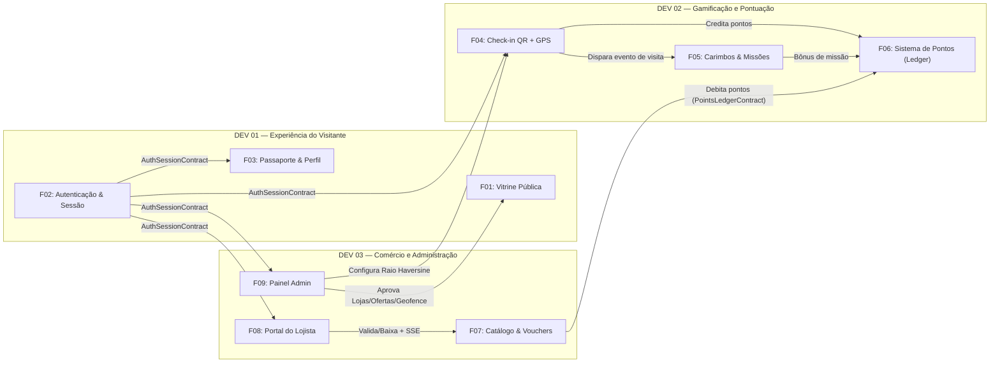
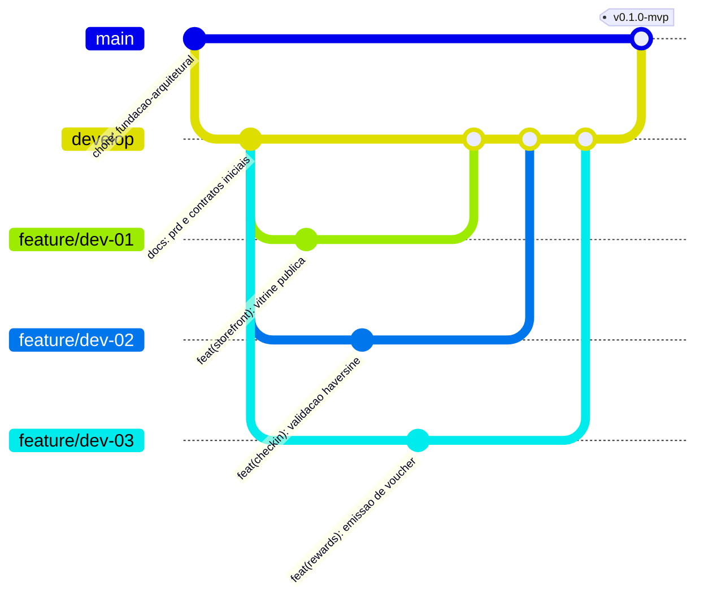

# Divisão de Equipe e Governança de Trabalho — 3 Desenvolvedores / 9 Funcionalidades

Este documento define a organização do trabalho paralelo entre os **três desenvolvedores**, garantindo isolamento de módulos, clareza de responsabilidades e ausência de conflitos de merge.

---

## 1. Mapa de Responsabilidades (9 Funcionalidades / Alocação Real do Trio)

> **Alocação Prática Definida pela Equipe:**
> - **Cristiano (Dev 01 + Dev 03 — Backend, APIs & Integração das 6 Features):** Assume as Frentes 01 e 03 (`F01`, `F02`, `F03`, `F07`, `F08`, `F09`). Veja o roteiro completo em [`docs/PLANO_EXECUCAO_DEV1_DEV3.md`](./PLANO_EXECUCAO_DEV1_DEV3.md).
> - **Amigo 01 (Dev 02 — Gamificação & Pontuação):** Assume a Frente 02 (`F04 Check-in QR/GPS`, `F05 Carimbos & Missões`, `F06 Sistema de Pontos & Extrato`).
> - **Amigo 02 (Especialista UI/UX — Refinamento de Telas):** Assume o refinamento visual de todas as páginas (`src/app/**/page.tsx`), componentes compartilhados (`src/components/*`), estilos (`src/styles/*`) e fidelidade aos protótipos (`prototipos/*`).

| Frente / Papel | Responsável | Funcionalidades sob Responsabilidade | Módulos (`src/modules/*`) | Rotas UI (`src/app/*`) | Rotas API (`src/app/api/*`) |
| :--- | :--- | :--- | :--- | :--- | :--- |
| **DEV 01**<br>*(Experiência do Visitante)* | **Cristiano** *(Back/API)* + **Amigo 02** *(UI/Telas)* | **F01:** Vitrine Pública e Lojas Parceiras<br>**F02:** Autenticação e Cadastro<br>**F03:** Passaporte e Perfil do Visitante | `storefront/`<br>`authentication/`<br>`visitor/` | `(public)/`<br>`(auth)/`<br>`(visitor)/passaporte/`<br>`(visitor)/perfil/` | `api/stores/*`<br>`api/auth/*`<br>`api/visitor/passport` |
| **DEV 02**<br>*(Gamificação e Pontuação)* | **Amigo 01** *(Back/API)* + **Amigo 02** *(UI/Telas)* | **F04:** Check-in e Validação por QR Code<br>**F05:** Gamificação, Carimbos e Missões<br>**F06:** Sistema de Pontos e Extrato | `checkin/`<br>`gamification/`<br>`points/` | `(visitor)/checkin/`<br>`(visitor)/missoes/`<br>`(visitor)/extrato/` | `api/checkins/*`<br>`api/visitor/points`<br>`api/visitor/missions` |
| **DEV 03**<br>*(Comércio e Administração)* | **Cristiano** *(Back/API)* + **Amigo 02** *(UI/Telas)* | **F07:** Catálogo de Recompensas e Vouchers<br>**F08:** Portal do Lojista<br>**F09:** Painel Administrativo | `rewards/`<br>`merchant/`<br>`administration/` | `(visitor)/recompensas/`<br>`(visitor)/vouchers/`<br>`lojista/*`<br>`admin/*` | `api/rewards/*`<br>`api/visitor/vouchers`<br>`api/merchant/*`<br>`api/admin/*`<br>`api/realtime/*` |

---

## 2. Propriedade de Diretórios (*Code Ownership*)

Para evitar que dois ou mais desenvolvedores editem os mesmos arquivos simultaneamente:

### Arquivos exclusivos do Desenvolvedor 01:
- `src/modules/storefront/**`
- `src/modules/authentication/**`
- `src/modules/visitor/**`
- `src/app/(public)/**`
- `src/app/(auth)/**`
- `src/app/(visitor)/passaporte/**`
- `src/app/(visitor)/perfil/**`
- `src/app/api/stores/**`
- `src/app/api/auth/**`
- `src/app/api/visitor/passport/**`

### Arquivos exclusivos do Desenvolvedor 02:
- `src/modules/checkin/**`
- `src/modules/gamification/**`
- `src/modules/points/**`
- `src/app/(visitor)/checkin/**`
- `src/app/(visitor)/missoes/**`
- `src/app/(visitor)/extrato/**`
- `src/app/api/checkins/**`
- `src/app/api/visitor/points/**`
- `src/app/api/visitor/missions/**`

### Arquivos exclusivos do Desenvolvedor 03:
- `src/modules/rewards/**`
- `src/modules/merchant/**`
- `src/modules/administration/**`
- `src/app/(visitor)/recompensas/**`
- `src/app/(visitor)/vouchers/**`
- `src/app/lojista/**`
- `src/app/admin/**`
- `src/app/api/rewards/**`
- `src/app/api/visitor/vouchers/**`
- `src/app/api/merchant/**`
- `src/app/api/admin/**`
- `src/app/api/realtime/**`

### Diretórios Compartilhados (Alteração somente via PR alinhado):
- `prisma/schema.prisma`
- `src/shared/**` (`types/`, `schemas/`, `constants/`, `utils/`)
- `src/components/**` (`ui/`, `layout/`, `shared/`)
- `src/infrastructure/**`

---

## 3. Dependências entre Funcionalidades e Interfaces Compartilhadas



### Contratos de Desacoplamento (Em `src/shared/types/domain.ts`):
1. **`AuthSessionContract` (Fornecido pelo Dev 01):** Utilitário em `src/infrastructure/authentication/session.ts` que retorna o usuário autenticado (`getCurrentSession()`). Enquanto o Dev 01 evolui o fluxo de OTP/OAuth, o Dev 02 e o Dev 03 já consomem o helper pronto.
2. **`PointsLedgerContract` (Fornecido pelo Dev 02):** Interface `IPointsLedgerService` que expõe `creditPoints(...)` e `debitPoints(...)`. O Dev 03 (no resgate de recompensas F07) invoca essa interface sem manipular a tabela `PointTransaction` diretamente.
3. **`GeofenceConfigContract` (Fornecido pelo Dev 03):** Parâmetros de latitude, longitude e raio (padrão 250m) lidos pelo módulo `checkin` (Dev 02).

---

## 4. Estratégia de Branches (Git Flow Simplificado por Desenvolvedor)



- **`main`**: Branch protegida contendo exclusivamente versões estáveis e homologadas.
- **`develop`**: Branch de integração contínua entre os 3 desenvolvedores.
- **Branches de Frente e Funcionalidade:**
  - **Desenvolvedor 01:** `feature/dev-01` (ou subdividida em `feature/dev-01-storefront`, `feature/dev-01-auth`, `feature/dev-01-passport`).
  - **Desenvolvedor 02:** `feature/dev-02` (ou subdividida em `feature/dev-02-checkin`, `feature/dev-02-gamification`, `feature/dev-02-points`).
  - **Desenvolvedor 03:** `feature/dev-03` (ou subdividida em `feature/dev-03-rewards`, `feature/dev-03-merchant`, `feature/dev-03-admin`).

---

## 5. Convenção de Commits (Conventional Commits)

Todos os commits devem seguir o padrão:
```text
<tipo>(<escopo>): <descrição curta no imperativo>
```
- **Tipos permitidos:** `feat`, `fix`, `refactor`, `docs`, `test`, `chore`, `style`.
- **Escopos permitidos:** `storefront`, `auth`, `visitor`, `checkin`, `gamification`, `points`, `rewards`, `merchant`, `admin`, `shared`, `prisma`.
- **Exemplos:**
  - `feat(checkin): adiciona calculo de distancia Haversine com raio de 250m`
  - `feat(points): implementa ledger imutavel para credito e debito`
  - `feat(merchant): cria validacao manual e por QR Code de vouchers`

---

## 6. Processo de Pull Request e Critérios Mínimos de Revisão

1. Todo Pull Request deve ser aberto apontando para a branch `develop`.
2. **Critérios obrigatórios para aprovação (Checklist de PR):**
   - [ ] O build TypeScript (`npm run typecheck` / `npm run build`) passa sem erros.
   - [ ] Nenhum arquivo exclusivo de outro desenvolvedor foi modificado sem alinhamento prévio.
   - [ ] Nenhuma regra de negócio foi colocada diretamente dentro de componentes React (`src/app` ou `src/components`).
   - [ ] Todas as entradas de API possuem validação com `Zod`.
   - [ ] Nenhuma alteração direta de saldo de pontos foi feita fora do serviço de Ledger (`PointTransaction`).
   - [ ] A identidade visual *Warm Editorial Mall* foi preservada.
   - [ ] Ao menos 1 (um) outro desenvolvedor da equipe revisou e aprovou o PR.
