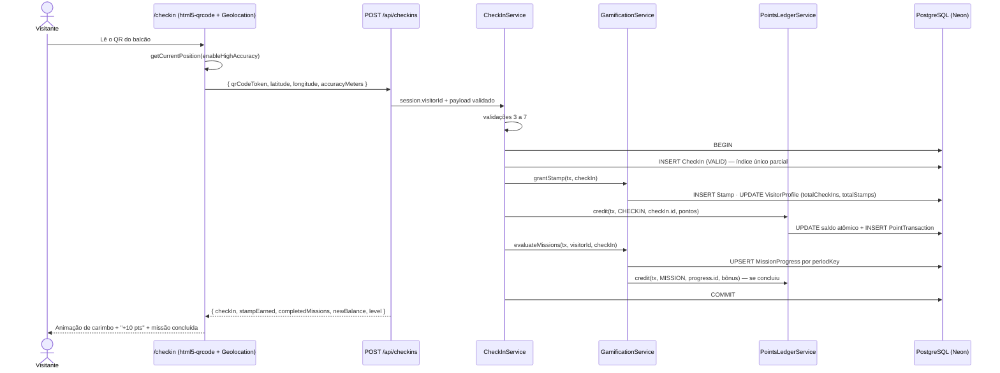

# Design Técnico — DEV 02: Gamificação e Pontuação

| Campo | Valor |
|---|---|
| **Responsável** | DEV 02 |
| **Branch** | `feature/dev-02` (sub-branches opcionais: `feature/dev-02-checkin`, `feature/dev-02-gamification`, `feature/dev-02-points`) |
| **Funcionalidades** | **F04** Check-in por QR Code + GPS · **F05** Carimbos, Missões e Níveis · **F06** Sistema de Pontos (Ledger) e Extrato |
| **Status** | 🟡 Em projeto — nenhum código alterado ainda |
| **Base** | `docs/TEAM_DIVISION.md`, `docs/BUSINESS_RULES.md`, `docs/API_CONTRACTS.md`, `prisma/schema.prisma`, `docs/Passaporte_do_Shopping_Atualizado.pdf` |
| **Protótipos** | `prototipos/tela_03_meu_passaporte_cupons(_desktop)` (abas Carimbos, Missões, Extrato) · card "Fazer Check-in" em `havanna_caf_ofertas_e_cupons` · Box 2 da `tela_01_vitrine_aberta` |

---

## 1. O que é meu (code ownership)

| Camada | Caminhos |
|---|---|
| Módulos | `src/modules/checkin/**` · `src/modules/gamification/**` · `src/modules/points/**` |
| Telas | `src/app/(visitor)/checkin/**` · `src/app/(visitor)/missoes/**` · `src/app/(visitor)/extrato/**` |
| API | `src/app/api/checkins/**` · `src/app/api/visitor/points/**` · `src/app/api/visitor/missions/**` (**rota nova**) |
| Contrato que eu **forneço** | `PointsLedgerContract` → `IPointsLedgerService` (usado pelo DEV 03 no resgate) |
| Contratos que eu **consumo** | `AuthSessionContract` (DEV 01) · `GeofenceConfigContract` (DEV 03) |
| Compartilhado (só via PR alinhado) | `prisma/schema.prisma` · `src/shared/**` · `src/infrastructure/**` |

---

## 2. Diagnóstico da fundação atual (o que precisa mudar)

Revisei o código da fundação (`e2c67e0`) nos meus módulos e nas dependências. Pontos encontrados:

| # | Severidade | Onde | Problema | Ação proposta |
|---|---|---|---|---|
| D-01 | 🔴 Crítico | `src/infrastructure/authentication/session.ts` (DEV 01) | O cookie de sessão é só JSON em base64, **sem assinatura**. Qualquer pessoa pode forjar `userId`/`role` e pontuar como outro visitante. | Pedir ao DEV 01 a troca por JWT assinado (`jose`, HS256 com `JWT_SECRET`). Meus endpoints passam a depender só de `getCurrentSession()`. |
| D-02 | 🔴 Crítico | `src/shared/constants` → `timezone: 'America/Araguaia'` | Esse fuso **não existe** no padrão IANA; `Intl.DateTimeFormat` lança `RangeError`. O correto é **`America/Araguaina`** (UTC-3). | PR em `shared` corrigindo a constante (e o texto do `BUSINESS_RULES.md`). |
| D-03 | 🔴 Crítico | `CheckInService` | A data do dia vem de `new Date().toISOString()` (UTC). Entre 21h e 23h59 em Palmas o check-in cai no **dia seguinte**, quebrando a regra de 1 por loja/dia. | Função `localDateKey()` com `America/Araguaina`. |
| D-04 | 🟠 Alto | `schema.prisma` → `CheckIn` | Só existe `@@index` em `(visitorId, storeId, checkInDate)`; dois toques rápidos no scanner geram **dois check-ins válidos** (condição de corrida). | Unicidade garantida no banco (ver §4.1). |
| D-05 | 🟠 Alto | `PointsLedgerService` | Lê o saldo, soma em memória e grava: com duas requisições simultâneas o `balanceAfter` fica errado; débito pode deixar saldo negativo. | Update atômico condicional dentro de `prisma.$transaction` (ver §6). |
| D-06 | 🟠 Alto | `CheckInService` | Grava check-in, carimbo e pontos em passos separados (não transacional) e **não avalia missões** (`completedMissions` nunca é preenchido). | Orquestrar tudo em uma única transação (ver §5). |
| D-07 | 🟡 Médio | `CheckInService` | Check-ins recusados não são gravados, mas a regra RN-01 pede registro para auditoria antifraude. | Gravar tentativas com `REJECTED_*` (sem pontos). |
| D-08 | 🟡 Médio | `createCheckInSchema` | `accuracyMeters` é aceito mas ignorado. | Recusar leituras com precisão pior que 150 m (P0-02). |
| D-09 | 🟡 Médio | Módulos | Tudo depende de `mock-data.ts` em memória. | Repositórios Prisma atrás de interfaces, mantendo um adaptador mock para demo sem banco. |

---

## 3. Decisões de negócio a alinhar com o time

A fundação e o PDF oficial divergem em valores. Proponho manter **o PDF como fonte da verdade** e deixar tudo configurável no banco (`Store.checkInPoints`, `Mission.*`, `SystemConfig`):

| Tema | PDF oficial | Fundação atual | **Proposta DEV 02** |
|---|---|---|---|
| Pontos por check-in | +10 | 35 a 70 por loja | Padrão **10** (campo por loja continua existindo) |
| Missão semanal | Explorador: 3 locais diferentes → +50 | `WEEKLY_GASTRO_03`: 3 categorias → +120 | **Explorador** `DISTINCT_STORES` 3 → +50 |
| Missão mensal | Frequente: 2 dias diferentes → +100 | `MONTHLY_EXPLORER_05`: 5 check-ins → +250 | **Frequente** `DISTINCT_DAYS` 2 → +100 |
| Missão de evento | Evento: 1 check-in em evento → +30 | não existe | **Evento** `SPECIFIC_STORE`/evento 1 → +30 |
| Missão diária | — | `DAILY_CHECKIN_01` +30 | Opcional (desligada por padrão) |
| Bônus de cadastro | +50 (protótipo) | "opcional" | +50 via `IPointsLedgerService` com `origin = PROMO_BONUS` (chamado pelo DEV 01) |
| Ponto de referência do raio | 250 m do shopping | centro do shopping | Centro do shopping (`SystemConfig`); coordenada por loja fica para evolução |
| Cooldown entre check-ins | — | — | **3 min** entre check-ins do mesmo visitante (P0-03) |
| Precisão mínima do GPS | — | — | `accuracyMeters ≤ 150` (P0-02) |

---

## 4. Alterações no schema (PR compartilhado)

### 4.1 Unicidade do check-in válido
O Prisma não expressa índice único parcial; a solução é uma migração SQL manual:

```sql
CREATE UNIQUE INDEX checkin_valid_once_per_day
  ON "CheckIn" ("visitorId", "storeId", "checkInDate")
  WHERE status = 'VALID';
```
Assim as tentativas recusadas continuam sendo gravadas, e o banco barra o segundo check-in válido (erro `P2002` → `409 DUPLICATE_DAILY_CHECKIN`).

### 4.2 Novos tipos de meta de missão
```prisma
enum MissionTargetType {
  CHECKIN_COUNT      // já existe — total de check-ins no período
  CATEGORY_VARIETY   // já existe — categorias diferentes
  SPECIFIC_STORE     // já existe — loja/evento específico
  DISTINCT_STORES    // NOVO — Explorador
  DISTINCT_DAYS      // NOVO — Frequente
}
```

### 4.3 Pequenos complementos
- `CheckIn.accuracyMeters Float?` e `CheckIn.rejectionReason String?` (auditoria).
- `Mission.targetStoreId String?` (para `SPECIFIC_STORE` / evento).
- `PointTransaction`: `@@unique([origin, referenceId])` para impedir crédito duplicado do mesmo check-in ou da mesma missão (idempotência).
- `SystemConfig` com as chaves `geofence.lat`, `geofence.lng`, `geofence.radiusMeters`, `checkin.cooldownSeconds`, `checkin.maxAccuracyMeters`.

---

## 5. F04 — Check-in por QR Code + GPS

### 5.1 Pipeline de validação (ordem importa: do mais barato ao mais caro)

| # | Validação | Falha → HTTP / código | Grava tentativa? |
|---|---|---|---|
| 1 | Sessão válida e `role = VISITOR` | `401 UNAUTHORIZED` | Não |
| 2 | Corpo válido (Zod) | `400 VALIDATION_ERROR` | Não |
| 3 | `accuracyMeters ≤ maxAccuracy` | `422 GPS_LOW_ACCURACY` | Não |
| 4 | `qrCodeToken` de loja ativa | `404 INVALID_QR_TOKEN` | Sim (`REJECTED_QR`, sem loja → só log) |
| 5 | Haversine ≤ raio | `422 GEOFENCE_OUT_OF_RANGE` | Sim (`REJECTED_DISTANCE`) |
| 6 | Cooldown desde o último check-in válido | `429 CHECKIN_COOLDOWN` | Não |
| 7 | Já existe válido hoje nessa loja | `409 DUPLICATE_DAILY_CHECKIN` | Sim (`REJECTED_DUPLICATE`) |
| 8 | Transação de sucesso (§5.2) | `201 Created` | Sim (`VALID`) |

### 5.2 Transação de sucesso



Todos os serviços recebem o `tx` (cliente da transação) como parâmetro, para que DEV 03 também possa compor o débito do resgate dentro da transação dele.

### 5.3 Tela `/checkin`
- Câmera com moldura de mira e botão de lanterna (`html5-qrcode`).
- Pede GPS só depois da leitura, com texto explicando o motivo.
- Estados: *Lendo QR* → *Verificando localização…* → sucesso (carimbo animado, pontos, missão atualizada) ou erro.
- Mensagens de erro (texto final na UI):

| Código | Mensagem |
|---|---|
| `GEOFENCE_OUT_OF_RANGE` | "Você está a 412 m do shopping. Aproxime-se para pontuar (limite de 250 m)." |
| `DUPLICATE_DAILY_CHECKIN` | "Você já carimbou o Havanna Café hoje. Volte amanhã ou visite outra loja!" |
| `CHECKIN_COOLDOWN` | "Aguarde alguns minutos para o próximo check-in." |
| `GPS_LOW_ACCURACY` | "Sinal de GPS fraco. Vá para perto de uma entrada ou janela e tente de novo." |
| `INVALID_QR_TOKEN` | "Este QR Code não pertence ao Passaporte Capim Dourado." |
| GPS negado (cliente) | Tutorial para liberar a localização no Android/iOS. |

---

## 6. F06 — Ledger de Pontos e Extrato

### 6.1 Contrato fornecido ao time (`src/modules/points/contracts.ts`)

```ts
export interface LedgerEntryInput {
  visitorId: string;
  amount: number;              // sempre > 0
  origin: PointTransactionOrigin;
  referenceId: string;         // checkIn.id, missionProgress.id, voucher.id...
  description: string;
}

export interface IPointsLedgerService {
  credit(tx: Prisma.TransactionClient, input: LedgerEntryInput): Promise<PointTransaction>;
  debit(tx: Prisma.TransactionClient, input: LedgerEntryInput): Promise<PointTransaction>; // lança INSUFFICIENT_POINTS
  getBalance(visitorId: string): Promise<{ currentPoints: number; lifetimePoints: number; level: PassportLevel }>;
  getStatement(visitorId: string, filter: StatementFilter): Promise<Paginated<PointTransaction>>;
}
```

### 6.2 Regras de implementação
- **Crédito:** `UPDATE "VisitorProfile" SET currentPoints = currentPoints + :x, lifetimePoints = lifetimePoints + :x WHERE id = :v RETURNING currentPoints, lifetimePoints` → `balanceAfter` vem do `RETURNING` (nunca de leitura prévia).
- **Débito:** mesmo update com `WHERE currentPoints >= :x`; 0 linhas afetadas → `INSUFFICIENT_POINTS`. O saldo nunca fica negativo.
- **Nível:** recalculado a partir de `lifetimePoints` após cada crédito (débito não rebaixa — RN-05). Se subir de nível, a resposta traz `levelUp: { from, to }` para a UI comemorar.
- **Idempotência:** `@@unique([origin, referenceId])` — repetir a mesma operação não credita duas vezes.
- **Reconciliação:** script `npm run ledger:check` que confere `SUM(créditos) − SUM(débitos) = currentPoints` para cada visitante (útil na demo e nos testes).
- Nenhum outro módulo atualiza `currentPoints` diretamente (RN-06).

### 6.3 `GET /api/visitor/points` (contrato existente)
- Query: `type=CREDIT|DEBIT`, `page`, `pageSize` (padrão 20), `origin` opcional.
- Resposta segue o `API_CONTRACTS.md` §3.7, acrescentando `meta.total` e `nextLevel: { id, label, pointsRemaining }`.

### 6.4 Tela `/extrato` (aba Extrato da Tela 03)
- Resumo no topo: saldo, total ganho, total gasto, nível e barra para o próximo nível.
- Filtros: **Todos · Ganhos · Gastos**.
- Linha do tempo agrupada por dia, ícone por origem: 📍 Check-in · 🎯 Missão · 🎟️ Resgate · 🎁 Bônus · ⚙️ Ajuste.
- Paginação infinita.

---

## 7. F05 — Carimbos, Missões e Níveis

### 7.1 Chave de período (`periodKey`) — sempre em `America/Araguaina`

| Frequência | Formato | Exemplo |
|---|---|---|
| `DAILY` | `AAAA-MM-DD` | `2026-11-13` |
| `WEEKLY` | `AAAA-Www` (ISO, segunda a domingo) | `2026-W46` |
| `MONTHLY` | `AAAA-MM` | `2026-11` |
| `SPECIAL` | `SPECIAL-<missionCode>` | `SPECIAL-NATAL26` |

### 7.2 Avaliação por tipo de meta (executada dentro da transação do check-in)

| `targetType` | Como calcular `currentCount` no período |
|---|---|
| `CHECKIN_COUNT` | Nº de check-ins `VALID` |
| `DISTINCT_STORES` | Nº de `storeId` distintos com check-in `VALID` |
| `DISTINCT_DAYS` | Nº de `checkInDate` distintos com check-in `VALID` |
| `CATEGORY_VARIETY` | Nº de categorias distintas (opcionalmente filtrando `targetCategory`) |
| `SPECIFIC_STORE` | Nº de check-ins `VALID` na `targetStoreId` |

Regras:
- Só avalia missões `isActive` e dentro de `startsAt/endsAt`.
- `MissionProgress` é criado sob demanda (`upsert` por `visitorId + missionId + periodKey`).
- Ao atingir `targetCount`: status `COMPLETED`, `completedAt`, crédito `origin = MISSION` com `referenceId = progress.id` (impede bônus duplicado).
- Períodos antigos aparecem como `EXPIRED` na leitura (sem *cron* no MVP).

### 7.3 Carimbos
- 1 carimbo por check-in válido (`badgeTitle` = "Selo <loja>", categoria da loja).
- A caderneta mostra **todas as lojas ativas**: carimbadas (coloridas, data e pontos) e pendentes (cinza).

### 7.4 `GET /api/visitor/missions` (**rota nova** — precisa entrar no `API_CONTRACTS.md`)

```json
{
  "success": true,
  "data": {
    "missions": [
      {
        "code": "WEEKLY_EXPLORER_03",
        "title": "Explorador da Semana",
        "frequency": "WEEKLY",
        "periodKey": "2026-W46",
        "targetCount": 3,
        "currentCount": 2,
        "rewardPoints": 50,
        "status": "IN_PROGRESS",
        "endsAt": "2026-11-16T02:59:59.999Z"
      }
    ],
    "stamps": {
      "collected": 3,
      "total": 6,
      "items": [{ "storeId": "store_01", "storeName": "Havanna Café", "category": "GASTRONOMIA", "earnedAt": "2026-11-13T17:30:00Z", "collected": true }]
    },
    "level": { "id": "BRONZE", "label": "Bronze Cerrado", "lifetimePoints": 320, "nextLevelAt": 500 }
  }
}
```

Para o DEV 01 montar `GET /api/visitor/passport`, exponho `GamificationService.getPassportSummary(visitorId)` com o mesmo formato (sem ele precisar acessar minhas tabelas).

### 7.5 Tela `/missoes` (abas Carimbos e Missões da Tela 03)
- **Carimbos:** progresso "3 de 6", grade de selos e aviso "1 carimbo por local/dia · raio de 250 m".
- **Missões:** cards com barra de progresso, prazo ("termina domingo"), recompensa e selo "✓ Concluída"; confete ao concluir.

---

## 8. Estrutura interna planejada dos meus módulos

```text
src/modules/
├── checkin/
│   ├── domain/        (regras puras: validações, códigos de erro, localDateKey)
│   ├── application/   (CheckInService — orquestra a transação)
│   ├── infrastructure/(CheckInRepository Prisma + versão mock)
│   └── index.ts       (API pública do módulo)
├── gamification/
│   ├── domain/        (periodKey, avaliadores por targetType, níveis)
│   ├── application/   (GamificationService, getPassportSummary)
│   ├── infrastructure/
│   └── index.ts
└── points/
    ├── contracts.ts   (IPointsLedgerService — contrato para o DEV 03)
    ├── domain/
    ├── application/   (PointsLedgerService)
    ├── infrastructure/
    └── index.ts
```

Telas e rotas continuam finas: validam com Zod, chamam o serviço e devolvem o envelope padrão — sem regra de negócio em componente (checklist de PR).

---

## 9. Plano de testes

| Tipo | Casos |
|---|---|
| **Unitário** | Haversine (já existe); `localDateKey` às 23h50 e 00h10 de Palmas; `periodKey` na virada de semana/mês/ano; cada avaliador de missão; cálculo de nível nas fronteiras (499/500, 1199/1200, 2999/3000). |
| **Integração** | Check-in feliz credita pontos, carimbo e missão; duplicado no mesmo dia → 409; **10 check-ins simultâneos** do mesmo QR → só 1 válido; débito maior que o saldo → erro e saldo intacto; crédito repetido com mesmo `referenceId` → ignorado; reconciliação do ledger fecha. |
| **E2E** | Login → `/checkin` com GPS simulado dentro/fora do raio → `/missoes` atualizado → `/extrato` mostra o lançamento. |

---

## 10. Backlog em ordem de execução

| # | Tarefa | Depende de | Commit sugerido |
|---|---|---|---|
| 1 | Alinhar decisões do §3 e o diagnóstico D-01/D-02 com o time | — | — |
| 2 | PR compartilhado: fuso `America/Araguaina`, enums e campos do §4, índice parcial, `SystemConfig` | 1 | `feat(prisma): adiciona unicidade de check-in e metas de missao` |
| 3 | Utilitários de data (`localDateKey`, `periodKey`) + testes | 2 | `feat(shared): utilitarios de data no fuso de Palmas` |
| 4 | Ledger atômico + contrato `IPointsLedgerService` + testes de concorrência | 2 | `feat(points): implementa ledger atomico e idempotente` |
| 5 | Avisar o DEV 03 que o contrato está pronto para o resgate | 4 | — |
| 6 | Avaliadores de missão, carimbos e níveis + `getPassportSummary` | 3, 4 | `feat(gamification): avalia missoes por periodo` |
| 7 | `CheckInService` transacional com pipeline do §5.1 | 4, 6 | `feat(checkin): check-in transacional com antifraude` |
| 8 | Rotas `POST /api/checkins`, `GET /api/visitor/points`, `GET /api/visitor/missions` + atualização do `API_CONTRACTS.md` | 7 | `feat(checkin): expoe rotas de check-in, pontos e missoes` |
| 9 | Telas `/checkin`, `/missoes`, `/extrato` fiéis aos protótipos (mobile e desktop) | 8 | `feat(gamification): telas de check-in, missoes e extrato` |
| 10 | Seed das missões oficiais e QR de teste; script `ledger:check` | 6 | `chore(points): seed de missoes e reconciliacao` |
| 11 | Testes E2E e PR para `develop` | 9 | — |

---

## 11. Critérios de aceite do DEV 02

- [ ] Check-in fora de 250 m ou com GPS impreciso é recusado com mensagem clara e fica registrado para auditoria.
- [ ] Impossível obter 2 check-ins válidos na mesma loja no mesmo dia (inclusive com toques simultâneos e às 23h50).
- [ ] Check-in válido gera, na mesma transação: carimbo, crédito no ledger e progresso de missões.
- [ ] Missão concluída credita o bônus **uma única vez** por período.
- [ ] Saldo nunca fica negativo e sempre bate com o `balanceAfter` da última transação.
- [ ] O DEV 03 consegue debitar pontos no resgate só pelo `IPointsLedgerService`.
- [ ] Telas `/checkin`, `/missoes` e `/extrato` seguem a identidade *Warm Editorial Mall* nos protótipos mobile e desktop.
- [ ] `npm run typecheck` e testes passando; PR revisado por outro dev.
