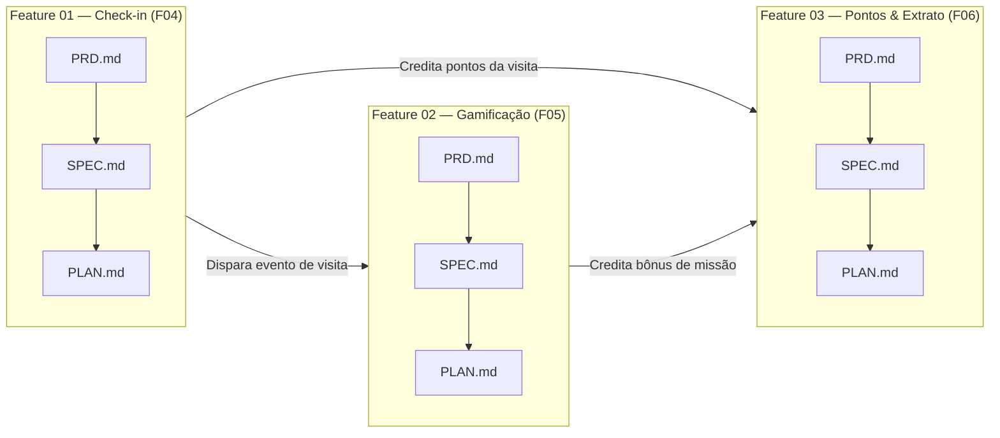

# 📂 Entrega DEV 02 (Felipe) — 3 Features (Metodologia Taurus)

Este diretório organiza a entrega do **Desenvolvedor 02 (Felipe — Frente de Gamificação e Pontuação)** dividida em **3 features**, seguindo o fluxo de trabalho definido pelo professor:

1. **`PRD.md` (*Product Requirement Document*):** Visão de produto da feature, requisitos funcionais, histórias de usuário, telas vinculadas e critérios de aceite.
2. **`SPEC.md` (*Technical Specification*):** Especificação técnica detalhada (camadas, regras de domínio, modelos Prisma, contratos de API, payloads e tratamento de erros).
3. **`PLAN.md` (*Planejamento da SPEC / `/plan`*):** Plano de execução sequencial em tarefas atômicas e verificáveis antes do *Start Implementation*.

---

## Mapa das 3 Features do DEV 02

| Ordem | Pasta da Feature | Funcionalidade | Módulo (`src/modules/*`) | Rota UI (`src/app/*`) | Rota API (`src/app/api/*`) | Documentos |
| :---: | :--- | :--- | :--- | :--- | :--- | :--- |
| **01** | [`feature-01-checkin/`](./feature-01-checkin/) | **F04 — Check-in e Validação por QR Code + GPS (Haversine 250m)** | `src/modules/checkin/` | `src/app/(visitor)/checkin/` | `POST /api/checkins` | [PRD](./feature-01-checkin/PRD.md) · [SPEC](./feature-01-checkin/SPEC.md) · [PLAN](./feature-01-checkin/PLAN.md) |
| **02** | [`feature-02-gamification/`](./feature-02-gamification/) | **F05 — Gamificação, Carimbos Digitais, Missões e Níveis** | `src/modules/gamification/` | `src/app/(visitor)/missoes/` | `GET /api/visitor/missions` | [PRD](./feature-02-gamification/PRD.md) · [SPEC](./feature-02-gamification/SPEC.md) · [PLAN](./feature-02-gamification/PLAN.md) |
| **03** | [`feature-03-points/`](./feature-03-points/) | **F06 — Sistema de Pontos e Extrato Auditável (Ledger)** | `src/modules/points/` | `src/app/(visitor)/extrato/` | `GET /api/visitor/points` | [PRD](./feature-03-points/PRD.md) · [SPEC](./feature-03-points/SPEC.md) · [PLAN](./feature-03-points/PLAN.md) |

---

## Fluxo de Trabalho entre as 3 Features

