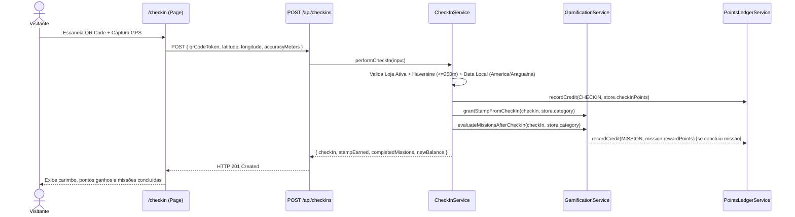

# SPEC — Feature 01: Check-in e Validação por QR Code + GPS (F04)

| Campo | Valor |
| :--- | :--- |
| **Feature** | Feature 01 (`F04`) — Check-in Presencial + Geofence Haversine |
| **Desenvolvedor** | Felipe (**DEV 02**) |
| **Arquivos sob Ownership** | `src/modules/checkin/**`, `src/app/(visitor)/checkin/**`, `src/app/api/checkins/**` |
| **Dependências Consumidas** | `validateGeofence` (`src/shared/utils/haversine.ts`), `getCurrentSession` (`src/infrastructure/authentication/session.ts`), `GamificationService` (`src/modules/gamification`), `PointsLedgerService` (`src/modules/points`) |

---

## 1. Arquitetura do Módulo (`src/modules/checkin/`)

O módulo `checkin` segue a separação em camadas definida em `docs/ARCHITECTURE.md`:

```text
src/modules/checkin/
├── domain/
│   ├── checkin-rules.ts       # Cálculo de data local (America/Araguaina), validação de precisão GPS e cooldown
│   └── checkin-errors.ts      # Códigos padronizados (INVALID_QR_TOKEN, GEOFENCE_OUT_OF_RANGE, DUPLICATE_DAILY_CHECKIN...)
├── application/
│   └── checkin.service.ts     # Orquestração do pipeline de validação e chamada atômica para Gamification + Points
├── infrastructure/
│   └── checkin.repository.ts  # Persistência Prisma / Mock em memória para CheckIn e consulta de Store/SystemConfig
└── index.ts                   # Exportação pública de CheckInService e tipos
```

---

## 2. Regras de Domínio e Fórmulas Técnicas

### 2.1 Fórmula de Haversine (RN-01)
Utiliza `validateGeofence(visitorCoords, shoppingCoords, maxRadiusMeters)` de `src/shared/utils/haversine.ts`:
- Coordenada central padrão (`SHOPPING_CONFIG.defaultCoordinates`): `latitude = -10.1845`, `longitude = -48.3337`.
- Raio máximo padrão (`SHOPPING_CONFIG.defaultGeofenceRadiusMeters`): `250` metros.
- Se `accuracyMeters` for informado pelo navegador e `accuracyMeters > 150`, retorna `422 GPS_LOW_ACCURACY` orientando o visitante a melhorar o sinal.

### 2.2 Data Civil no Fuso Horário Local de Palmas (RN-02)
Para evitar que check-ins feitos entre `21:00` e `23:59` (horário de Palmas, UTC-3) caiam no dia seguinte em UTC:
```ts
export function getLocalCheckInDate(date: Date = new Date()): string {
  // Retorna "YYYY-MM-DD" no fuso America/Araguaina (UTC-3)
  return new Intl.DateTimeFormat('en-CA', {
    timeZone: 'America/Araguaina',
    year: 'numeric',
    month: '2-digit',
    day: '2-digit',
  }).format(date);
}
```

### 2.3 Pipeline de Validação em `CheckInService.performCheckIn`

| Ordem | Regra Verificada | Status do Registro `CheckIn` | Retorno HTTP e Código |
| :---: | :--- | :--- | :--- |
| 1 | Payload validado via `createCheckInSchema` (Zod) | Não grava | `400 VALIDATION_ERROR` |
| 2 | `accuracyMeters <= 150` (quando enviado) | Não grava | `422 GPS_LOW_ACCURACY` |
| 3 | `qrCodeToken` corresponde a uma `Store` com `isActive = true` | Não grava (sem `storeId` válido) | `404 INVALID_QR_TOKEN` |
| 4 | Distância Haversine `distanceMeters <= maxRadiusMeters` (250 m) | Grava `REJECTED_DISTANCE` (`pointsAwarded: 0`) | `422 GEOFENCE_OUT_OF_RANGE` |
| 5 | Não existe `CheckIn` com `status = 'VALID'` para `(visitorId, storeId, checkInDate)` | Grava `REJECTED_DUPLICATE` (`pointsAwarded: 0`) | `409 DUPLICATE_DAILY_CHECKIN` |
| 6 | Check-in aprovado | Grava `VALID` (`pointsAwarded: store.checkInPoints`) | `201 Created` |

---

## 3. Modelo de Dados Relacionado (`prisma/schema.prisma`)

```prisma
model CheckIn {
  id               String         @id @default(cuid())
  visitorId        String
  storeId          String
  checkInDate      String         // Formato YYYY-MM-DD (Fuso America/Araguaina)
  latitude         Float
  longitude        Float
  distanceMeters   Float
  isWithinGeofence Boolean
  status           CheckInStatus  // VALID | REJECTED_DISTANCE | REJECTED_DUPLICATE | REJECTED_QR
  pointsAwarded    Int            @default(0)
  createdAt        DateTime       @default(now())

  visitor          VisitorProfile @relation(fields: [visitorId], references: [id], onDelete: Cascade)
  store            Store          @relation(fields: [storeId], references: [id], onDelete: Cascade)
  stamps           Stamp[]

  @@index([visitorId, storeId, checkInDate])
}
```

---

## 4. Contrato de API (`POST /api/checkins`)

### Request (`application/json`)
Validado por `createCheckInSchema` em `src/shared/schemas/api.schemas.ts`:
```json
{
  "qrCodeToken": "QR-CD-STORE-01-VERIFIED",
  "latitude": -10.184412,
  "longitude": -48.333648,
  "accuracyMeters": 18
}
```

### Response `201 Created`
```json
{
  "success": true,
  "data": {
    "checkIn": {
      "id": "chk_01",
      "visitorId": "vis_01",
      "storeId": "store_01",
      "storeName": "Café Jalapão Gourmet",
      "checkInDate": "2026-11-13",
      "distanceMeters": 12,
      "isWithinGeofence": true,
      "status": "VALID",
      "pointsAwarded": 40,
      "createdAt": "2026-11-13T22:15:00.000Z"
    },
    "stampEarned": {
      "id": "stp_01",
      "badgeTitle": "Selo Café Jalapão Gourmet",
      "category": "GASTRONOMIA"
    },
    "completedMissions": [
      {
        "id": "mis_01",
        "code": "DAILY_CHECKIN_01",
        "title": "Visita Premiada do Dia",
        "rewardPoints": 30
      }
    ],
    "newBalance": 710
  },
  "meta": {
    "timestamp": "2026-11-13T22:15:00.000Z"
  }
}
```

### Responses de Erro (`400`, `404`, `409`, `422`)
```json
{
  "success": false,
  "error": {
    "code": "GEOFENCE_OUT_OF_RANGE",
    "message": "Você está a 412m do Capim Dourado Shopping. O raio máximo permitido para check-in presencial é de 250m.",
    "details": {
      "isWithinGeofence": false,
      "distanceMeters": 412,
      "maxRadiusMeters": 250
    }
  }
}
```

---

## 5. Diagrama de Sequência


