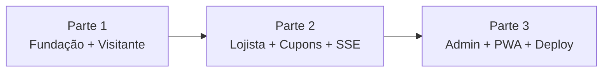

# 📐 Tech Spec — Passaporte do Shopping (Capim Dourado)

A entrega foi dividida em **3 partes incrementais**. Cada parte gera uma versão demonstrável do sistema e serve de base para a próxima.

| Parte | Documento | Foco | Telas cobertas | Resultado demonstrável |
|---|---|---|---|---|
| **1** | [Parte 1 — Fundação e Jornada do Visitante](./parte-1-fundacao-e-visitante.md) | Base do projeto, vitrine aberta, autenticação, check-in com GPS, carimbos, missões e extrato | 01, 01.1, 02 (2A/2B/2C), 03 (Carimbos, Missões, Extrato) | Visitante navega sem login, cria conta, escaneia QR e ganha pontos |
| **2** | [Parte 2 — Lojista, Cupons e Tempo Real](./parte-2-lojista-cupons-tempo-real.md) | Portal do lojista, ofertas, resgate de vouchers, baixa no caixa e **SSE** (tecnologia sorteada) | 04 (4A/4B), 01.1 (resgate), 03 (Trocar Pontos, Meus Cupons) | Cliente resgata cupom → atendente valida → tela do cliente muda sozinha |
| **3** | [Parte 3 — Administração, PWA e Entrega Final](./parte-3-admin-pwa-entrega.md) | Painel do shopping, aprovação de ofertas, gerador de QR, indicadores, PWA, deploy e roteiro da banca | 05, banners da 01, instalação PWA | Shopping gerencia lojas, aprova ofertas, imprime QR e acompanha indicadores |

## Convenções comuns às 3 partes

- **Stack:** Next.js (App Router) + TypeScript + React + Tailwind CSS · Prisma ORM (SQLite no MVP / PostgreSQL em produção) · JWT em cookie `HttpOnly` · `bcryptjs` · `Zod` · `html5-qrcode` / `qrcode` · SSE nativo.
- **Arquitetura:** monólito modular em 4 camadas (Apresentação → Route Handlers/SSE → Domain Services → Persistência).
- **Referência visual:** protótipos em [`/prototipos`](../../prototipos) (versões mobile e `_desktop`) e Design System [`aura_dourada_mobile/DESIGN.md`](../../prototipos/aura_dourada_mobile/DESIGN.md).
- **Regras de negócio:** [`docs/Passaporte_do_Shopping_Atualizado.pdf`](../Passaporte_do_Shopping_Atualizado.pdf).
- **Perfis de acesso:** `VISITANTE`, `LOJISTA`, `ADMIN`.
- **Definição de pronto (DoD) de cada parte:** telas fiéis ao protótipo (mobile e desktop), validações com Zod no servidor, critérios de aceite atendidos e fluxo demonstrável com dados de seed.

> [!NOTE]
> Estes documentos descrevem **o que será construído**. Nenhuma estrutura funcional (código) foi criada no repositório até o momento; as estruturas de pastas citadas são **planejadas**.

> [!IMPORTANT]
> A divisão de trabalho oficial entre os desenvolvedores está em [`docs/TEAM_DIVISION.md`](../TEAM_DIVISION.md) e é diferente das 3 partes acima: **DEV 01** = Visitante (F01–F03), **DEV 02** = Gamificação e Pontuação (F04–F06), **DEV 03** = Comércio e Administração (F07–F09). O design detalhado do DEV 02 está em [`docs/dev-02/`](../dev-02/DESIGN_DEV02_GAMIFICACAO_PONTUACAO.md).
