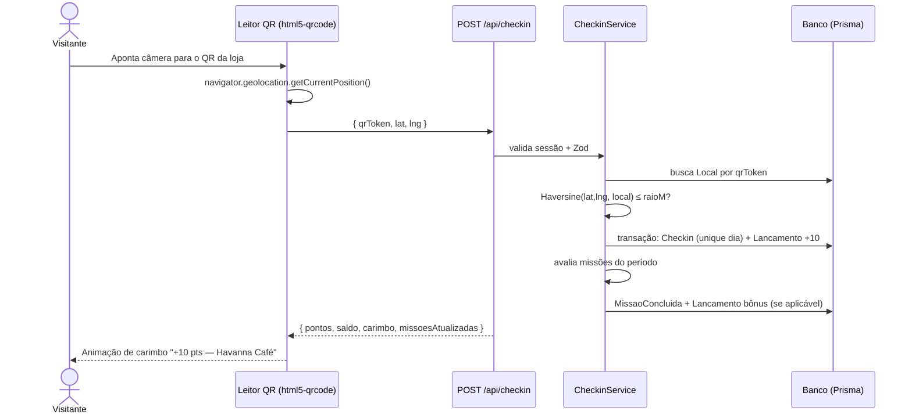

# Tech Spec — Parte 1: Fundação e Jornada do Visitante

| Campo | Valor |
|---|---|
| **Status** | Planejado |
| **Depende de** | — |
| **Bloqueia** | Parte 2 e Parte 3 |
| **Telas** | 01 Vitrine Aberta · 01.1 Página da Loja (visualização + check-in) · 02 Autenticação (2A Entrar, 2B Criar Conta, 2C OTP) · 03 Meu Passaporte (abas Carimbos, Missões, Extrato) |
| **Protótipos** | `tela_01_vitrine_aberta(_desktop)`, `havanna_caf_ofertas_e_cupons` / `havanna_caf_detalhes_da_loja_desktop`, `tela_02_login_e_cadastro(_desktop)`, `tela_02_criar_conta_cadastro`, `confirma_o_de_c_digo_whatsapp(_desktop)`, `tela_03_meu_passaporte_cupons(_desktop)` |

---

## 1. Objetivo

Entregar a base técnica do projeto e o ciclo principal de engajamento: **o visitante entra sem login, cria conta, escaneia o QR Code de uma loja dentro do shopping e ganha pontos, carimbos e progresso em missões.**

## 2. Escopo

### Dentro do escopo
- Setup do projeto (Next.js, TypeScript, Tailwind com tokens do Design System *Aura Dourada*, Prisma, ESLint).
- Layout base responsivo (mobile com barra inferior / desktop com navegação superior).
- Vitrine aberta: cabeçalho, busca, Box 1 (destaques — dados de seed), Box 2 (chamada para escanear + missão), carrossel de lojas, chips de categoria.
- Página da loja: hero, informações, card "Loja do Passaporte" com **check-in**, listagem de ofertas (somente leitura).
- Autenticação do visitante: cadastro, login, logout, sessão JWT, bônus de boas-vindas (+50 pts), verificação OTP (simulada no MVP).
- Leitor de QR Code com validação de GPS (raio de 250 m).
- Carimbos, missões (Explorador, Frequente, Evento) e extrato.

### Fora do escopo (próximas partes)
- Resgate de vouchers, carteira "Meus Cupons", baixa ao vivo → **Parte 2**.
- Portal do lojista → **Parte 2**.
- Painel admin, gerador de QR, aprovação de ofertas, PWA instalável → **Parte 3**.
- Login com Google e envio real de WhatsApp/SMS → evolução futura (botões presentes na UI, desabilitados ou simulados).

## 3. Regras de negócio

| Código | Regra |
|---|---|
| RN-01 | Vitrine, lojas e ofertas são públicas; pontuar e resgatar exigem login. |
| RN-02 | Cadastro concede **+50 pts** de boas-vindas (uma única vez por conta). |
| RN-03 | Check-in vale **+10 pts** e **1 carimbo por local por dia** (fuso `America/Araguaina`). |
| RN-04 | Check-in só é aceito se a distância (Haversine) entre o visitante e o shopping for **≤ 250 m** (raio configurável por local na Parte 3). |
| RN-05 | Missão **Explorador:** 3 locais diferentes na semana (seg–dom) → **+50 pts**. |
| RN-06 | Missão **Frequente:** check-ins em 2 dias diferentes no mês → **+100 pts**. |
| RN-07 | Missão **Evento:** 1 check-in em local do tipo `EVENTO` no mês → **+30 pts**. |
| RN-08 | Cada bônus de missão é creditado **uma vez por período** (garantido por chave única). |
| RN-09 | Todo crédito/débito gera um lançamento no extrato; o saldo é a soma dos lançamentos. |
| RN-10 | Senha: mínimo 8 caracteres, 1 número e 1 caractere especial. Aceite LGPD obrigatório. |
| RN-11 | OTP: 6 dígitos, validade de 5 min, máx. 5 tentativas, reenvio após 60 s. |

## 4. Modelo de dados (Prisma — planejado)

```prisma
enum Perfil      { VISITANTE LOJISTA ADMIN }
enum TipoLocal   { LOJA ALIMENTACAO EVENTO SERVICO }
enum TipoLanc    { CHECKIN BONUS_MISSAO BOAS_VINDAS RESGATE ESTORNO }
enum TipoMissao  { EXPLORADOR FREQUENTE EVENTO }

model Usuario {
  id            String   @id @default(cuid())
  nome          String
  email         String   @unique
  telefone      String   @unique
  senhaHash     String
  perfil        Perfil   @default(VISITANTE)
  telefoneVerif Boolean  @default(false)
  aceiteLgpdEm  DateTime
  optinMarketing Boolean @default(false)
  criadoEm      DateTime @default(now())
  checkins      Checkin[]
  lancamentos   Lancamento[]
}

model Loja {
  id        String   @id @default(cuid())
  slug      String   @unique
  nome      String
  categoria String
  piso      String
  horario   String
  logoUrl   String?
  capaUrl   String?
  ativa     Boolean  @default(true)
  locais    Local[]
}

model Local {
  id        String    @id @default(cuid())
  nome      String
  tipo      TipoLocal
  qrToken   String    @unique      // conteúdo assinado do QR físico
  latitude  Float
  longitude Float
  raioM     Int       @default(250)
  pontos    Int       @default(10)
  lojaId    String?
  loja      Loja?     @relation(fields: [lojaId], references: [id])
  checkins  Checkin[]
}

model Checkin {
  id        String   @id @default(cuid())
  usuarioId String
  localId   String
  dia       String   // "AAAA-MM-DD" no fuso local
  distM     Int
  criadoEm  DateTime @default(now())
  usuario   Usuario  @relation(fields: [usuarioId], references: [id])
  local     Local    @relation(fields: [localId], references: [id])
  @@unique([usuarioId, localId, dia])   // RN-03
}

model Lancamento {
  id        String   @id @default(cuid())
  usuarioId String
  tipo      TipoLanc
  pontos    Int      // positivo = crédito, negativo = débito
  descricao String
  refId     String?  // checkin, missão ou voucher de origem
  criadoEm  DateTime @default(now())
  usuario   Usuario  @relation(fields: [usuarioId], references: [id])
}

model MissaoConcluida {
  id        String     @id @default(cuid())
  usuarioId String
  tipo      TipoMissao
  periodo   String     // "2026-W46" ou "2026-11"
  @@unique([usuarioId, tipo, periodo])  // RN-08
}

model CodigoOtp {
  id         String   @id @default(cuid())
  telefone   String
  codigoHash String
  tentativas Int      @default(0)
  expiraEm   DateTime
}
```

## 5. API (Route Handlers — planejado)

| Método | Rota | Acesso | Descrição |
|---|---|---|---|
| GET | `/api/vitrine` | Público | Destaques, lojas, categorias e missão em destaque |
| GET | `/api/lojas/[slug]` | Público | Dados da loja e ofertas ativas (somente leitura) |
| POST | `/api/auth/cadastro` | Público | Cria conta, credita +50 pts, dispara OTP |
| POST | `/api/auth/otp/enviar` | Público | Gera/reenvia código (simulado: exibido no log/console em dev) |
| POST | `/api/auth/otp/verificar` | Público | Valida código e marca telefone verificado |
| POST | `/api/auth/login` | Público | Valida credenciais e grava cookie JWT `HttpOnly` |
| POST | `/api/auth/logout` | Logado | Remove cookie |
| GET | `/api/me` | Visitante | Perfil, saldo e nível |
| POST | `/api/checkin` | Visitante | `{ qrToken, lat, lng }` → valida GPS, regra diária e missões |
| GET | `/api/passaporte/carimbos` | Visitante | Locais carimbados / pendentes |
| GET | `/api/passaporte/missoes` | Visitante | Progresso de cada missão no período |
| GET | `/api/passaporte/extrato?tipo=` | Visitante | Lançamentos (Ganhos / Gastos / Todos) |

**Respostas de erro do check-in:** `FORA_DO_RAIO`, `JA_CARIMBADO_HOJE`, `QR_INVALIDO`, `GPS_AUSENTE`.

## 6. Fluxo principal — Check-in



## 7. Estrutura de pastas planejada

```text
src/
├── app/
│   ├── (publico)/page.tsx                 # Tela 01
│   ├── (publico)/loja/[slug]/page.tsx     # Tela 01.1
│   ├── (auth)/entrar/ · criar-conta/ · verificar/   # Tela 02
│   ├── (visitante)/passaporte/page.tsx    # Tela 03
│   └── api/ (auth, vitrine, lojas, checkin, passaporte, me)
├── components/ (ui, vitrine, passaporte, scanner)
├── server/
│   ├── services/ (checkin, missoes, pontos, auth, otp)
│   └── lib/ (haversine, jwt, prisma, validacao)
└── prisma/ (schema.prisma, seed.ts)
```

## 8. Critérios de aceite

- [ ] Vitrine e página da loja abrem sem login, fiéis aos protótipos mobile e desktop.
- [ ] Tentar escanear/check-in deslogado abre a Tela 02 e, após login, retorna à ação pendente.
- [ ] Cadastro valida campos (Zod), exibe força da senha, exige LGPD e credita +50 pts.
- [ ] Tela OTP aceita 6 dígitos com auto-avanço, colar e backspace; contador de reenvio funciona.
- [ ] Check-in fora de 250 m é recusado com a mensagem correta.
- [ ] Segundo check-in no mesmo local e dia é recusado.
- [ ] Missões avançam e creditam bônus uma única vez por período.
- [ ] Extrato reflete exatamente o saldo exibido no cartão do passaporte.

## 9. Riscos e mitigação

| Risco | Mitigação |
|---|---|
| GPS impreciso em ambientes fechados | Usar `enableHighAccuracy`, raio de 250 m e mensagem orientando a tentar novamente |
| Câmera/GPS exigem HTTPS | Desenvolvimento em `localhost`; demo em domínio com HTTPS |
| Envio real de WhatsApp tem custo | OTP simulado no MVP, mantendo a interface pronta para integrar um provedor |
| Fraude por check-in remoto | GPS + QR assinado + 1 carimbo/local/dia |
