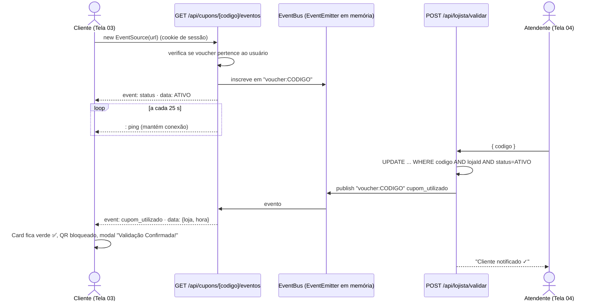

# Tech Spec — Parte 2: Lojista, Cupons e Tempo Real

| Campo | Valor |
|---|---|
| **Status** | Planejado |
| **Depende de** | Parte 1 (usuários, lojas, pontos, extrato) |
| **Bloqueia** | Parte 3 (aprovação de ofertas, indicadores de cupons) |
| **Telas** | 04A Login do Lojista · 04B Painel do Lojista · 01.1 Página da Loja (ofertas + resgate) · 03 Meu Passaporte (abas Trocar Pontos e Meus Cupons) |
| **Protótipos** | `tela_de_login_do_lojista` / `login_do_lojista_desktop`, `tela_04_painel_do_lojista_valida_o_de_caixa` / `tela_04_painel_do_lojista_desktop`, `havanna_caf_ofertas_e_cupons`, `tela_03_meu_passaporte_cupons(_desktop)` |
| **Tecnologia sorteada** | 🔴 Backend e Dados — **Dados em tempo real** |

---

## 1. Objetivo

Dar **autonomia ao lojista** (modelo *Tenant Mix*) para publicar ofertas do dia e cupons por pontos, permitir que o visitante **troque pontos por vouchers** e implementar a **baixa do cupom ao vivo**: quando o atendente confirma o uso, a tela do cliente atualiza sozinha via **Server-Sent Events (SSE)**.

## 2. Escopo

### Dentro do escopo
- Login do lojista por **CNPJ + senha** (contas criadas pelo seed nesta parte; pela admin na Parte 3).
- Painel do lojista: KPIs do turno, validação de voucher (QR ou código), confirmação de uso, últimos atendimentos.
- CRUD de ofertas: **Oferta do Dia** (sem pontos, preço de/por) e **Cupom por Pontos** (custo, estoque, limite por cliente, validade).
- Status de oferta: `RASCUNHO → PENDENTE → ATIVA → PAUSADA/ENCERRADA` (aprovação manual entra na Parte 3; nesta parte ofertas vão direto para `ATIVA`).
- Resgate de voucher pelo visitante com débito atômico de pontos e estoque.
- Carteira "Meus Cupons" (Ativos · Utilizados · Expirados) com QR Code e código.
- Canal SSE por voucher e atualização automática da tela do cliente.

### Fora do escopo
- Fila de aprovação e gestão de lojas pela administração → **Parte 3**.
- Biometria real (Touch ID / Face ID) → botão visual; possível evolução via WebAuthn/Passkeys.
- Integração com PDV/ERP da loja.

## 3. Regras de negócio

| Código | Regra |
|---|---|
| RN-20 | Lojista só vê e altera ofertas e vouchers **da própria loja** (isolamento multi-loja). |
| RN-21 | Resgate exige saldo ≥ custo, estoque > 0 e limite por cliente não atingido. |
| RN-22 | Resgate é **atômico**: debita pontos, decrementa estoque e cria voucher na mesma transação. |
| RN-23 | Voucher tem validade de **2 horas** após o resgate; depois disso passa a `EXPIRADO`. |
| RN-24 | Código do voucher: prefixo da loja + 5 caracteres (`HVN-84920`), único, sem caracteres ambíguos. |
| RN-25 | Baixa só ocorre se o voucher for da loja do atendente e estiver `ATIVO` (update condicional impede uso duplo em dois caixas). |
| RN-26 | Após a baixa, o evento `cupom_utilizado` é enviado **apenas** ao dono do voucher. |
| RN-27 | Voucher expirado sem uso **não** devolve os pontos no MVP (regra exibida ao cliente no rodapé da página da loja). |
| RN-28 | Ofertas do Dia não consomem pontos e não geram voucher; são informativas com regras. |

## 4. Modelo de dados (adições ao Prisma)

```prisma
enum TipoOferta    { OFERTA_DIA CUPOM_PONTOS }
enum StatusOferta  { RASCUNHO PENDENTE ATIVA PAUSADA ENCERRADA RECUSADA }
enum StatusVoucher { ATIVO UTILIZADO EXPIRADO }

model ContaLojista {
  id        String  @id @default(cuid())
  cnpj      String  @unique
  senhaHash String
  operador  String
  lojaId    String
  loja      Loja    @relation(fields: [lojaId], references: [id])
}

model Oferta {
  id            String       @id @default(cuid())
  lojaId        String
  tipo          TipoOferta
  status        StatusOferta @default(RASCUNHO)
  titulo        String
  descricao     String
  regras        String
  imagemUrl     String?
  precoDe       Decimal?
  precoPor      Decimal?
  descontoPct   Int?
  custoPontos   Int?
  estoque       Int?
  limitePorCliente Int       @default(1)
  inicioEm      DateTime
  fimEm         DateTime
  motivoRecusa  String?
  loja          Loja         @relation(fields: [lojaId], references: [id])
  vouchers      Voucher[]
}

model Voucher {
  id          String        @id @default(cuid())
  codigo      String        @unique
  ofertaId    String
  usuarioId   String
  status      StatusVoucher @default(ATIVO)
  pontos      Int
  expiraEm    DateTime
  utilizadoEm DateTime?
  operador    String?
  criadoEm    DateTime      @default(now())
  oferta      Oferta        @relation(fields: [ofertaId], references: [id])
}
```

## 5. API (planejado)

| Método | Rota | Acesso | Descrição |
|---|---|---|---|
| POST | `/api/lojista/login` | Público | CNPJ + senha → cookie JWT perfil `LOJISTA` |
| GET | `/api/lojista/resumo` | Lojista | KPIs do turno (resgatados, baixados, taxa, check-ins) |
| GET/POST | `/api/lojista/ofertas` | Lojista | Lista (Ativas/Agendadas/Encerradas) e cria oferta |
| PATCH/DELETE | `/api/lojista/ofertas/[id]` | Lojista | Editar, pausar, duplicar, encerrar, repor estoque |
| GET | `/api/lojista/vouchers/[codigo]` | Lojista | Consulta para conferência (válido, utilizado, outra loja, expirado) |
| POST | `/api/lojista/validar` | Lojista | Confirma uso → `UTILIZADO` + publica evento SSE |
| GET | `/api/lojista/historico` | Lojista | Últimos atendimentos (CSV opcional) |
| GET | `/api/passaporte/catalogo` | Visitante | Cupons por pontos disponíveis (filtros por faixa/loja) |
| POST | `/api/vouchers` | Visitante | `{ ofertaId }` → resgate atômico |
| GET | `/api/passaporte/cupons?status=` | Visitante | Carteira de vouchers |
| GET | `/api/cupons/[codigo]/eventos` | Dono do voucher | **Stream SSE** (`text/event-stream`) |

## 6. Tempo real — desenho técnico



**Detalhes de implementação**
- Route Handler com `ReadableStream` (Web Streams API), headers `Content-Type: text/event-stream`, `Cache-Control: no-cache`, `Connection: keep-alive`; `export const dynamic = 'force-dynamic'` e `runtime = 'nodejs'`.
- Cancelamento da inscrição no `request.signal` `abort` (evita vazamento de memória).
- Cliente: hook `useVoucherAoVivo(codigo)` com `EventSource`; ao reconectar (`onopen`), busca o status atual via `GET /api/passaporte/cupons` para não perder eventos.
- EventBus em memória funciona com **uma instância** do servidor; para várias instâncias, substituir por Redis Pub/Sub ou `LISTEN/NOTIFY` do PostgreSQL (mesma interface).

## 7. Estrutura de pastas planejada (adições)

```text
src/
├── app/
│   ├── lojista/login/page.tsx            # Tela 04A
│   ├── lojista/(painel)/page.tsx         # Tela 04B — Validar
│   ├── lojista/(painel)/ofertas/ · historico/ · loja/
│   └── api/ (lojista/*, vouchers, cupons/[codigo]/eventos)
├── components/ (lojista, carteira, ofertas)
├── hooks/useVoucherAoVivo.ts
└── server/
    ├── services/ (ofertas, resgate, validacao)
    └── realtime/eventBus.ts
```

## 8. Critérios de aceite

- [ ] Lojista entra com CNPJ mascarado e senha; não acessa dados de outra loja (teste com 2 lojas).
- [ ] Lojista cria Oferta do Dia e Cupom por Pontos; ambos aparecem na página da loja.
- [ ] Visitante sem saldo vê o cupom como "🔒 Bloqueado / Faltam X pts".
- [ ] Dois resgates simultâneos do último item resultam em apenas 1 voucher.
- [ ] Voucher aparece em "Meus Cupons" com QR, código e contagem regressiva de validade.
- [ ] Validação de voucher de outra loja, expirado ou já utilizado mostra a mensagem correta.
- [ ] **Com o cupom aberto no celular do cliente, a confirmação no painel do lojista muda a tela do cliente em até 2 s, sem recarregar.**
- [ ] Ao derrubar e restabelecer a conexão, a tela do cliente mostra o status correto.

## 9. Riscos e mitigação

| Risco | Mitigação |
|---|---|
| Hospedagem serverless encerra conexões longas | Deploy em servidor Node persistente (`next start` em Render/Railway/VPS) |
| Proxy faz buffer do stream | Header `X-Accel-Buffering: no` e pings periódicos |
| Print do QR reutilizado | Status muda no servidor; baixa condicional impede reuso |
| Corrida de estoque | Transação + `UPDATE ... WHERE estoque > 0` |
